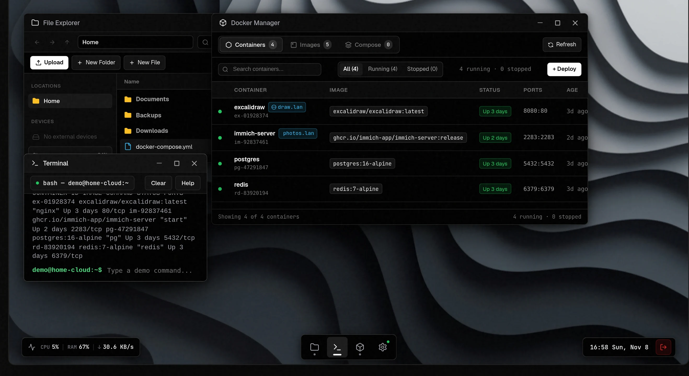

# Home Cloud

[](LICENSE)
[](https://nodejs.org)
[](#requirements)

A self-hosted dashboard for one Linux machine. It gives you a terminal, Docker and Compose, a file manager and system stats in the browser, at home or from anywhere through a Cloudflare Tunnel. You don't need to open ports or have a static IP.

[](https://home-cloud.live/#demo)

**[Try the live demo](https://home-cloud.live/#demo)** in your browser · **[Docs](https://home-cloud.live/docs/)**

## Install

```bash
curl -fsSL https://raw.githubusercontent.com/Cypher0071/Home_Cloud/main/setup.sh | bash
```

The installer sets up the latest release with everything it needs: Node.js, pnpm, Docker, and optionally `cloudflared` for remote access. Each download is pinned and checked against a SHA256, and nothing from the internet is piped into a shell. It runs Home Cloud as a systemd service under your user, never as root. Run it again to update, or use the Update button in Settings.

For remote access you need a domain on Cloudflare. The installer opens a Cloudflare login link and creates the tunnel and the `dash.<domain>` record.

Flags, unattended installs and manual setup: [Install guide](https://home-cloud.live/docs/getting-started/install/).

## What you get

- **Terminal**: a real shell on the host, in the browser.
- **Docker and Compose**: run, start, stop and delete containers, with live logs, stats and a shell into each one. The Run form checks port mappings before it starts anything. You can also edit and deploy Compose stacks.
- **Files**: browse, upload and download across your disks. By default access is limited to your home folder and mounted drives.
- **Expose apps**: put a container on `<name>.<domain>` through the same tunnel, without opening a port.
- **System monitor and updates**: CPU, memory, disk and network use, plus one-click updates to the latest release with rollback if the update fails.

At home, the dashboard switches to the machine's LAN address, so uploads and the terminal skip the tunnel.

## Security model

Home Cloud is built for one person who owns the machine. **Signing in gives a host shell and the Docker socket, which is root-equivalent.** Treat the password that way.

- Over the internet, put **[Cloudflare Access](https://home-cloud.live/docs/getting-started/remote-access/#protect-the-dashboard-with-cloudflare-access)** in front of `dash.<domain>`, so only your email can reach the login page. It is free and takes a few minutes.
- Logins are rate-limited (5 failures a minute, then a 5-minute lockout). Session cookies are `HttpOnly`, `SameSite=Lax` and host-only.
- Logout, "log out everywhere" and password changes invalidate every session and close open terminals and streams.
- The service runs as your user, not root. No inbound ports are opened; the tunnel connects outward.

Details: [Threat model](https://home-cloud.live/docs/security/threat-model/) · [SECURITY.md](SECURITY.md) · [Automated audit report](docs/security_audit/REPORT.md)

## Requirements

- Linux with systemd and sudo. Supported: Ubuntu, Debian, Fedora, yum-based distros and Arch, including WSL2.
- x86_64. The installer has ARM64 builds, but ARM and Raspberry Pi are untested.
- Optional: a domain on Cloudflare (free plan) for remote access.

## Develop

```bash
git clone https://github.com/Cypher0071/Home_Cloud && cd Home_Cloud
pnpm install
cp agent/.env.example agent/.env   # set PASSWORD and JWT_SECRET; the agent won't start with the placeholders
pnpm dev                           # dashboard on :5173, agent on :3000
```

See [CONTRIBUTING.md](CONTRIBUTING.md), the [architecture notes](https://home-cloud.live/docs/project/architecture/) and the [roadmap](docs/future_roadmap.md).

## License

[Apache 2.0](LICENSE)
