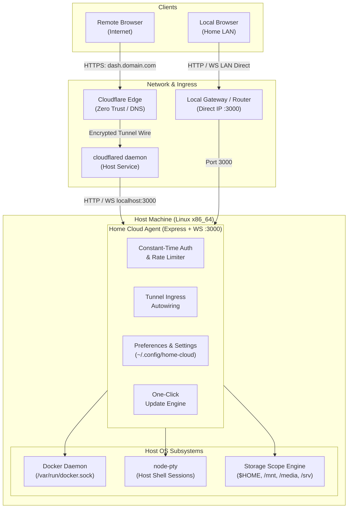

# Home Cloud

[](LICENSE)
[](https://nodejs.org)
[](https://www.docker.com)
[](#requirements--compatibility)
[](#contributing)

A unified, lightweight homelab control plane and dashboard for Linux servers.

Turn any spare PC or old laptop into your own personal VPS. Effortlessly access and manage your machine from anywhere, over your local network or securely across the internet, without the headache of port forwarding, static IPs, router NAT rules, or complex VPN setups.

Access your host terminal, Docker engine, Compose stacks, multi-drive filesystem, and system vitals from any browser worldwide via Cloudflare Zero Trust Tunnels, backed by automatic direct LAN acceleration when you are at home.

---

## Why Home Cloud?

Most home server dashboards fall into two traps:
1. **Consumer app-store appliances** (CasaOS, Umbrel) that consume excess memory with multi-user scaffolding, opinionated app wrappers, and slow web wrappers.
2. **Fragmented toolchains** that require juggling Portainer, Cockpit, Nginx Proxy Manager, dynamic DNS clients, and router port-forwarding rules.

Home Cloud is built around a single-user ownership philosophy:
- **Zero Port Forwarding**: Exposes your dashboard and Docker containers securely across the internet using Cloudflare Named Tunnels. Bypasses CGNAT and residential firewalls completely.
- **Split-Horizon LAN Acceleration**: Automatically detects when your device is on the same local network and switches connections directly to the local IP for zero-latency, full-gigabit file uploads and terminal sessions.
- **Single Machine Ownership**: Purpose-built for one administrator. Authenticating gives you direct host shell and Docker engine access without artificial privilege barriers.
- **Minimal Overhead**: Single Node.js agent + lightweight React 19 single-page desktop workspace with no heavy background runtimes or app store daemons.

---

## Architecture Overview



---

## Core Features

### 🖥️ Web Desktop Environment
- Draggable, resizable, multi-window application management.
- Quick-launch dock, active process indicator, and system status tray.
- Keyboard navigation and shortcut controls.
- Responsive design tailored for desktop workstations, laptops, and mobile screens.

### 🐳 Docker & Compose Engine
- Real-time container metrics (CPU utilization %, memory footprint, block I/O, network traffic).
- One-click container lifecycle operations (start, stop, restart, pause, delete).
- Interactive web-based `docker exec` terminal directly into running containers.
- Live streaming stdout/stderr container logs.
- Interactive Docker Compose stack editor with template presets and live deployment streaming.

### 💻 Host Web Terminal
- Full-featured, low-latency pseudo-terminal powered by `node-pty` and `xterm.js`.
- True PTY terminal session running directly under your host Linux user account.
- Dynamic window resizing, font scaling, full 256-color / ANSI rendering, and clipboard integration.

### 📁 Multi-Drive Storage & File Explorer
- Dynamic disk discovery for mounted storage pools, internal NVMe/SSDs, and external drives (`/mnt`, `/media`, `/run/media`, `/srv`).
- **Safe Server Mode** (default): Constrains filesystem access to `$HOME` and mounted data pools while safeguarding system binaries.
- **Full System Root Access Mode**: Allows administrative access across the entire Linux root (`/`) filesystem.
- **Permanent Kernel Protection**: Hardcoded kernel filesystem guards strictly block `/proc`, `/sys`, and `/dev` traversal across all modes to prevent host descriptor leaks.
- Integrated file viewing, text editing, uploading, batch downloads, copying, and renaming.

### 🌐 Zero-Config Cloudflare Ingress Autowiring
- Automates Cloudflare Named Tunnel routing without touching manual Nginx, Traefik, or Caddy configuration files.
- Automatically creates public subdomains (e.g., `grafana.yourdomain.com`) for exposed Docker services by modifying `~/.cloudflared/config.yml` on the fly.

### ⚙️ Cross-Device Settings & Preferences Sync
- Centralized server-side persistence stored at `~/.config/home-cloud/preferences.json`.
- Synchronizes storage scope permissions, custom directory mounts, and desktop personalization across all browser sessions and devices.
- Built-in desktop wallpaper presets with support for custom image uploads and static caching.

### 🛡️ Hardened Single-User Security
- **Constant-Time Authentication**: Mitigates side-channel timing attacks using pre-hashed SHA-256 buffers via `crypto.timingSafeEqual`.
- **Sliding-Window Rate Limiting**: Enforces brute-force lockout (5 failed attempts within 60s triggers an automatic 5-minute IP quarantine with `Retry-After` headers).
- **Session Revocation (Token Epoch)**: "Log Out Everywhere" instantly revokes all active browser cookies and WebSocket connections across all devices by incrementing the server-side token epoch.
- **Credential Autofill & Biometrics**: Standard `<form>` credentials semantics paired with hidden identity bindings allow Google Password Manager, Chrome Autofill, Samsung Pass, and Apple Keychain to save credentials and unlock the dashboard using biometrics (Windows Hello, Fingerprint, Face Unlock).
- **Dynamic Passcode Management**: Change master server passcodes directly from the dashboard with atomic `.env` rewrites.

### 🔄 One-Click Auto-Update Engine
- Automatic check against GitHub release tags with semantic versioning comparisons.
- Multi-stage, real-time Server-Sent Events (SSE) progress pipeline: `Preflight` ➔ `Fetch` ➔ `Build` ➔ `Restart`.
- Automated git snapshot capture before updates with automatic rollback if installation or frontend compilation fails.
- Smooth watchdog reconnection: polls `/api/ping` during service restart and auto-refreshes the browser when the server is back online.

---

## Quickstart

### Option 1: 1-Command Automated Installer (Recommended)

Run the following command on a fresh Linux server:

```bash
curl -fsSL https://raw.githubusercontent.com/Cypher0071/home_cloud/main/setup.sh | bash
```

The installer detects your Linux distribution, resolves dependencies, configures your Cloudflare Tunnel, generates secure secrets, and sets up a systemd background service.

#### Non-Interactive & Automation Flags

For automated deployments or cloud-init scripts, pass CLI flags:

```bash
curl -fsSL https://raw.githubusercontent.com/Cypher0071/home_cloud/main/setup.sh | bash -s -- \
  --domain "example.com" \
  --tunnel "my-tunnel" \
  --password "YourStrongPassword123" \
  --dir "/opt/home-cloud" \
  --yes
```

Available flags:
- `-d, --domain <domain>`: Cloudflare root domain for tunnel routing.
- `-p, --password <pass>`: Dashboard master password.
- `--tunnel <name>`: Cloudflare tunnel name (default: `home-cloud`).
- `--dir <path>`: Target installation directory (default: `$HOME/home-cloud`).
- `-y, --yes, --non-interactive`: Accept defaults and skip all interactive prompts.
- `--skip-cloudflared`: Skip Cloudflare Tunnel installation (LAN-only setup).
- `--dry-run`: Validate dependencies and configuration without changing the system.

---

### Option 2: Manual Installation & Developer Setup

#### 1. Clone & Install Dependencies

```bash
git clone https://github.com/Cypher0071/home_cloud.git
cd home_cloud
pnpm install
```

#### 2. Configure Environment

Copy the example configuration:

```bash
cp agent/.env.example agent/.env
```

Edit `agent/.env` with your desired configuration:

```bash
PASSWORD=your-secure-password
JWT_SECRET=$(openssl rand -hex 32)
CF_DOMAIN=example.com
TUNNEL_NAME=home-cloud
```

#### 3. Build & Run

**Production:**
```bash
# Build dashboard assets
pnpm --filter dashboard build

# Start the agent
pnpm --filter agent start
```

**Development Mode (Vite HMR + Nodemon):**
```bash
pnpm dev
```
The Vite development server runs on `http://localhost:5173` and proxies API requests and WebSockets to the agent on `http://localhost:3000`.

---

## Configuration Reference

### Environment Variables (`agent/.env`)

| Variable | Default | Description |
| :--- | :--- | :--- |
| `PASSWORD` | *(required)* | Master dashboard login passcode. |
| `JWT_SECRET` | *(required)* | Secret key used to sign and verify session JWT cookies. |
| `PORT` | `3000` | Local HTTP and WebSocket port for the agent server. |
| `BASE_DIR` | `os.homedir()` | Root directory for the File Explorer under Safe Mode. |
| `CF_DOMAIN` | *(optional)* | Cloudflare root domain for ingress autowiring (e.g. `example.com`). |
| `TUNNEL_NAME` | `home-cloud` | Cloudflare Named Tunnel identifier. |
| `CF_CONFIG` | `~/.cloudflared/config.yml` | Location of the Cloudflare Tunnel ingress configuration file. |
| `COOKIE_SECURE` | `true` | Enforces `Secure` flag on JWT cookies. Set to `false` only if running without HTTPS on plain LAN. |
| `ALLOW_SYSTEM_ROOT`| `false` | When `true`, enables full system root (`/`) filesystem browsing across storage endpoints. |

### Persistent Settings (`~/.config/home-cloud/preferences.json`)

Runtime settings are persisted dynamically by the agent:
```json
{
  "allowSystemRoot": false,
  "customStoragePaths": [],
  "sessionEpoch": 1,
  "personalization": {
    "presetId": "macos-sonoma",
    "fit": "cover",
    "hasCustomWallpaper": false,
    "customWallpaperExt": null
  }
}
```

---

## Requirements & Compatibility

| Component | Minimum Requirement | Verified & Supported |
| :--- | :--- | :--- |
| **OS** | Linux | Ubuntu (22.04 / 24.04 LTS), Debian 12, Fedora (39+), Arch Linux |
| **Architecture** | x86_64 / amd64 | *Note: ARM64 (e.g. Raspberry Pi) is currently untested.* |
| **Node.js** | `>= 20.0.0` | Node.js 20 LTS, Node.js 22 LTS |
| **Package Manager**| `pnpm >= 9.0.0` | Recommended for monorepo workspace dependencies |
| **Docker** | `24.0.0+` | User running the agent must be a member of the `docker` group |
| **Cloudflare** | Free Account | Domain managed on Cloudflare DNS with a Named Tunnel configured |

---

## Benchmarks

> [!NOTE]
> Formal benchmarks are coming soon.
> 
> Reproducible performance metrics (including idle memory footprint, cold-start latency, WebSocket throughput under concurrent terminal streams, and direct LAN vs. Cloudflare Tunnel transfer speeds across standard host hardware) are currently being compiled and will be published in this section.

---

## Security Model & Threat Boundaries

Home Cloud is explicitly architected around a **single-user administrator model**:
- **Root-Equivalent Access**: Having access to the dashboard password provides execution capabilities via the host terminal (`node-pty`) and the Docker socket (`/var/run/docker.sock`). Protect your master password and use strong passwords.
- **No Inbound Open Ports**: Because ingress is managed over an outbound Cloudflare Tunnel connection, your server does not require public static IP addresses, DDNS updaters, or open router/firewall NAT ports.
- **Private Network Access (PNA)**: LAN micro-pings strictly return sanitized `{ status: "ok" }` payloads and respect W3C Private Network Access specifications.
- **Zero Kernel Exposure**: Even when **Full System Root Mode** is enabled, paths under `/proc`, `/sys`, and `/dev` remain permanently blocked to prevent descriptor leakage or kernel thread blocking.

---

## Roadmap

To view upcoming features, technical debt trackers, and scheduled post-1.0 milestones (including container crash watchdogs and automated volume backups), see:
- [`docs/future_roadmap.md`](docs/future_roadmap.md)
- [`docs/TECHNICAL_DEBT.md`](docs/TECHNICAL_DEBT.md)

---

## Contributing

Contributions, bug reports, and pull requests are welcome!
- Please read our [Contributing Guidelines](CONTRIBUTING.md) before submitting a pull request.
- Review our [Security Policy](SECURITY.md) for responsible vulnerability disclosures.

---

## License

This project is licensed under the **Apache License, Version 2.0**. See the [LICENSE](LICENSE) file for details.
