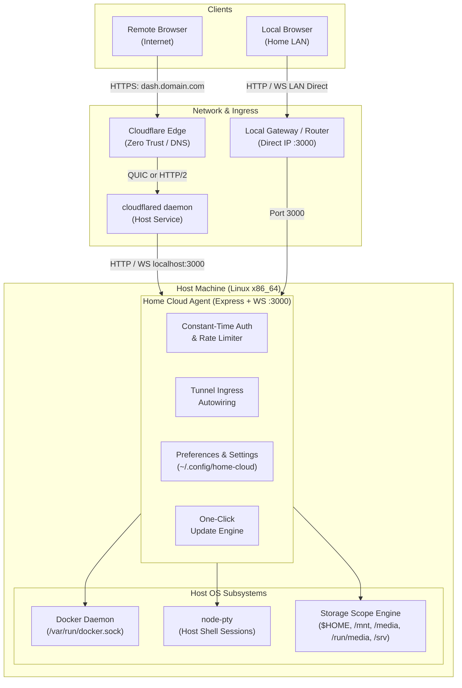

# Home Cloud

[](LICENSE)
[](https://nodejs.org)
[](https://www.docker.com)
[](#requirements--compatibility)
[](#contributing)

A unified, lightweight homelab control plane and dashboard for Linux servers.

Turn any spare PC or old laptop into your own personal VPS. Effortlessly access and manage your machine from anywhere, over your local network or securely across the internet, without the headache of port forwarding, static IPs, router NAT rules, or complex VPN setups.

Access your host terminal, Docker engine, Compose stacks, multi-drive filesystem, and system vitals from any browser worldwide via Cloudflare Zero Trust Tunnels, backed by automatic direct LAN acceleration when you are at home.

---

## Why Home Cloud?

Most home server dashboards fall into two traps:
1. **Consumer app-store appliances** (CasaOS, Umbrel) that consume excess memory with multi-user scaffolding, opinionated app wrappers, and slow web wrappers.
2. **Fragmented toolchains** that require juggling Portainer, Cockpit, Nginx Proxy Manager, dynamic DNS clients, and router port-forwarding rules.

Home Cloud is built around a single-user ownership philosophy:
- **Zero Port Forwarding**: Exposes your dashboard and Docker containers securely across the internet using Cloudflare Named Tunnels. Bypasses CGNAT and residential firewalls completely.
- **Split-Horizon LAN Acceleration**: Automatically detects when your device is on the same local network and switches connections directly to the local IP for zero-latency, full-gigabit file uploads and terminal sessions.
- **Single Machine Ownership**: Purpose-built for one administrator. Authenticating gives you direct host shell and Docker engine access without artificial privilege barriers.
- **Minimal Overhead**: Single Node.js agent + lightweight React 19 single-page desktop workspace with no heavy background runtimes or app store daemons.

---

## Architecture Overview



---

## Core Features

### 🖥️ Web Desktop Environment
- Draggable, resizable, multi-window application management.
- Quick-launch dock, active process indicator, and system status tray.
- Keyboard navigation and shortcut controls.
- Responsive design tailored for desktop workstations, laptops, and mobile screens.

### 🐳 Docker & Compose Engine
- Real-time container metrics (CPU utilization %, memory footprint, block I/O, network traffic).
- Container lifecycle operations: start, stop, restart, and delete. There is no container pause.
- Interactive web-based `docker exec` terminal directly into running containers.
- Live streaming stdout/stderr container logs.
- Interactive Docker Compose stack editor with template presets and live deployment streaming.

### 💻 Host Web Terminal
- Full-featured, low-latency pseudo-terminal powered by `node-pty` and `xterm.js`.
- True PTY terminal session running directly under your host Linux user account.
- Dynamic window resizing, font scaling, full 256-color / ANSI rendering, and clipboard integration.

### 📁 Multi-Drive Storage & File Explorer
- Dynamic disk discovery for mounted storage pools, internal NVMe/SSDs, and external drives (`/mnt`, `/media`, `/run/media`, `/srv`).
- **Safe Server Mode** (default): Constrains filesystem access to `$HOME` and mounted data pools while safeguarding system binaries.
- **Full System Root Access Mode**: Allows administrative access across the entire Linux root (`/`) filesystem.
- **Permanent Kernel Protection**: Hardcoded kernel filesystem guards strictly block `/proc`, `/sys`, and `/dev` traversal across all modes to prevent host descriptor leaks.
- File actions: view, upload, download one path, copy, rename, move, and create an empty file. There is no in-browser text editor and no batch download.
- View sends the file as an attachment except for `.png`, `.jpg`, `.jpeg`, `.webp`, and `.gif`, and sets `X-Content-Type-Options: nosniff`. HTML and SVG are not shown inline.

### 🌐 Cloudflare Ingress Autowiring
- When `CF_DOMAIN` is set, exposing a container edits `~/.cloudflared/config.yml` and restarts `cloudflared`. It does not call the Cloudflare DNS API.
- `CF_DOMAIN` has no default. If it is unset, ingress autowiring does not write that config.
- The installer publishes DNS only for `dash.$DOMAIN`. Other names need a wildcard CNAME (or a record you create yourself) before they resolve.

### ⚙️ Cross-Device Settings & Preferences Sync
- Centralized server-side persistence stored at `~/.config/home-cloud/preferences.json`.
- Synchronizes storage scope permissions, custom directory mounts, and desktop personalization across all browser sessions and devices.
- Built-in desktop wallpaper presets with support for custom image uploads and static caching.

### 🛡️ Hardened Single-User Security
- **Constant-Time Authentication**: Mitigates side-channel timing attacks using pre-hashed SHA-256 buffers via `crypto.timingSafeEqual`.
- **Fixed-window rate limiting**: 5 failures within 60 seconds, then a 5 minute lockout with `Retry-After`. This is not exponential backoff. The window uses the TCP peer address. `CF-Connecting-IP` is honored only when that peer is loopback (the local `cloudflared`). Clients cannot rotate `X-Forwarded-For` to reset the window.
- **Session revocation (token epoch)**: Logout and "log out everywhere" both increment `sessionEpoch` and reject old JWTs on HTTP and WebSocket.
- **Host-only cookie**: `HttpOnly`, `SameSite=Lax`, no `Domain` attribute, and `Secure` on HTTPS. It is not sent to sibling hostnames such as `grafana.example.com`.
- **Credential Autofill & Biometrics**: Standard `<form>` credentials semantics paired with hidden identity bindings allow Google Password Manager, Chrome Autofill, Samsung Pass, and Apple Keychain to save credentials and unlock the dashboard using biometrics (Windows Hello, Fingerprint, Face Unlock).
- **Dynamic Passcode Management**: Change master server passcodes directly from the dashboard with atomic `.env` rewrites.

### 🔄 One-Click Auto-Update Engine
- Automatic check against GitHub release tags with semantic versioning comparisons.
- Multi-stage, real-time Server-Sent Events (SSE) progress pipeline: `Preflight` ➔ `Fetch` ➔ `Build` ➔ `Restart`.
- Before an update, the agent records the current git SHA. Rollback checks out that previous SHA. It does not rebuild the old `dashboard/dist` by itself.
- Smooth watchdog reconnection: polls `/api/ping` during service restart and auto-refreshes the browser when the server is back online.

---

## Quickstart

### Option 1: 1-Command Automated Installer (Recommended)

The raw installer URL tracks the repository default branch (`main`):

```bash
curl -fsSL https://raw.githubusercontent.com/Cypher0071/Home_Cloud/main/setup.sh | bash
```

Node.js `>= 22.13` and Docker must already be installed. The installer does not pipe NodeSource, `get.pnpm.io`, `get.docker.com`, or `cloudflared` `releases/latest`. It installs pnpm through corepack at the pinned version (`12.15.0`). `cloudflared` is optional and is downloaded only at a pinned release after sha256 verification. The installer then configures the tunnel when you ask it to, writes `agent/.env`, and installs a systemd service.

The systemd unit runs as the install user, not root. The installer refuses `User=root` when there is no `SUDO_USER` and no `HOME_CLOUD_SERVICE_USER`.

#### Non-Interactive & Automation Flags

For automated deployments or cloud-init scripts, pass CLI flags:

```bash
curl -fsSL https://raw.githubusercontent.com/Cypher0071/Home_Cloud/main/setup.sh | bash -s -- \
  --domain "example.com" \
  --tunnel "my-tunnel" \
  --password "YourStrongPassword123" \
  --dir "/opt/home-cloud" \
  --yes
```

Available flags:
- `--help`: Print usage and exit.
- `--branch <name>`: Git branch to clone.
- `--check-only`, `--dry-run`: Validate prerequisites, flags, and configuration without changing the system.
- `-d, --domain <domain>`: Cloudflare root domain for tunnel routing. This sets `CF_DOMAIN`. It does not default to any domain.
- `-p, --password <pass>`: Dashboard master password (at least 8 characters).
- `--tunnel <name>`: Cloudflare tunnel name (default: `home-cloud`).
- `--dir <path>`: Target installation directory (default: `$HOME/home-cloud`).
- `-y, --yes`, `--non-interactive`: Accept defaults and skip interactive prompts.
- `--skip-cloudflared`: Skip the optional `cloudflared` download and tunnel setup (LAN-only).

---

### Option 2: Manual Installation & Developer Setup

#### 1. Clone & Install Dependencies

```bash
git clone https://github.com/Cypher0071/Home_Cloud
cd Home_Cloud
pnpm install
```

#### 2. Configure Environment

Copy the example configuration:

```bash
cp agent/.env.example agent/.env
```

Copying `agent/.env.example` and starting the agent without changing `PASSWORD` and `JWT_SECRET` will refuse to boot. Replace both placeholders before you start it.

Edit `agent/.env` with your desired configuration:

```bash
PASSWORD=your-secure-password
JWT_SECRET=$(openssl rand -hex 32)
CF_DOMAIN=example.com
TUNNEL_NAME=home-cloud
```

#### 3. Build & Run

**Production:**
```bash
# Build dashboard assets
pnpm --filter dashboard build

# Start the agent
pnpm --filter agent start
```

**Development Mode (Vite HMR + Nodemon):**
```bash
pnpm dev
```
The Vite development server runs on `http://localhost:5173` and proxies API requests and WebSockets to the agent on `http://localhost:3000`.

---

## Configuration Reference

### Environment Variables (`agent/.env`)

| Variable | Default | Description |
| :--- | :--- | :--- |
| `PASSWORD` | *(required, no safe default)* | Master dashboard login passcode. The agent refuses to listen if this is missing, shorter than 8 characters, or `change-me`. |
| `JWT_SECRET` | *(required, no safe default)* | Secret used to sign session JWTs. The agent refuses to listen if this is missing, shorter than 16 characters, or `generate-a-long-random-string`. |
| `PORT` | `3000` | Listen port (`process.env.PORT`). HTTP and WebSocket share it. |
| `BASE_DIR` | `os.homedir()` | Home directory used as one file-route root under Safe Server Mode. `/mnt`, `/media`, `/run/media`, `/srv`, and custom paths are also allowed. `/proc`, `/sys`, and `/dev` stay blocked. |
| `CF_DOMAIN` | *(unset)* | Cloudflare root domain. There is no default. If unset, ingress autowiring does not write `~/.cloudflared/config.yml`. |
| `TUNNEL_NAME` | `home-cloud` | Cloudflare Named Tunnel identifier. |
| `CF_CONFIG` | `~/.cloudflared/config.yml` | Location of the Cloudflare Tunnel ingress configuration file. |
| `COOKIE_SECURE` | `true` on HTTPS | Session cookie is `HttpOnly`, `SameSite=Lax`, and host-only (no `Domain` attribute). `Secure` is set on HTTPS. Set this to `false` only for plain HTTP on a LAN. |
| `ALLOW_SYSTEM_ROOT`| `false` | When `true`, enables full system root (`/`) filesystem browsing across storage endpoints. |

### Persistent Settings (`~/.config/home-cloud/preferences.json`)

Runtime settings are persisted dynamically by the agent:
```json
{
  "allowSystemRoot": false,
  "customStoragePaths": [],
  "sessionEpoch": 1,
  "personalization": {
    "presetId": "macos-sonoma",
    "fit": "cover",
    "hasCustomWallpaper": false,
    "customWallpaperExt": null
  }
}
```

---

## Requirements & Compatibility

| Component | Minimum Requirement | Verified & Supported |
| :--- | :--- | :--- |
| **OS** | Linux | Ubuntu and Debian (apt), Fedora (dnf), yum-based distros, Arch Linux (pacman) |
| **Architecture** | x86_64 / amd64 | ARM64 / Raspberry Pi is untested. |
| **Node.js** | `>= 22.13` | Node.js 20 is not supported. |
| **Package Manager**| pnpm `12.15.0` | Pinned version, installed with corepack. Not `pnpm >= 9`. |
| **Docker** | `24.0.0+` | Must already be installed. The user running the agent must be in the `docker` group. |
| **Cloudflare** | Free Account | Domain managed on Cloudflare DNS with a Named Tunnel configured |

---

## Benchmarks

> [!NOTE]
> Formal benchmarks are coming soon.
> 
> Reproducible performance metrics (including idle memory footprint, cold-start latency, WebSocket throughput under concurrent terminal streams, and direct LAN vs. Cloudflare Tunnel transfer speeds across standard host hardware) are currently being compiled and will be published in this section.

---

## Security Model & Threat Boundaries

Home Cloud is explicitly architected around a **single-user administrator model**:
- **Root-Equivalent Access**: Having access to the dashboard password provides execution capabilities via the host terminal (`node-pty`) and the Docker socket (`/var/run/docker.sock`). Protect your master password and use strong passwords.
- **No Inbound Open Ports**: Ingress uses outbound `cloudflared` (QUIC or HTTP/2). The server does not need a public static IP, a DDNS updater, or open router ports.
- **Session cookie**: `HttpOnly`, `SameSite=Lax`, host-only, and `Secure` on HTTPS. Logout and "log out everywhere" both increment `sessionEpoch`.
- **Service user**: The systemd unit runs as the install user, not root. The installer refuses `User=root` when there is no `SUDO_USER` and no `HOME_CLOUD_SERVICE_USER`.
- **Private Network Access (PNA)**: LAN micro-pings strictly return sanitized `{ status: "ok" }` payloads and respect W3C Private Network Access specifications.
- **Zero Kernel Exposure**: Even when **Full System Root Mode** is enabled, paths under `/proc`, `/sys`, and `/dev` remain permanently blocked to prevent descriptor leakage or kernel thread blocking.

---

## Roadmap

To view upcoming features, technical debt trackers, and scheduled post-1.0 milestones (including container crash watchdogs and automated volume backups), see:
- [`docs/future_roadmap.md`](docs/future_roadmap.md)
- [`docs/TECHNICAL_DEBT.md`](docs/TECHNICAL_DEBT.md)

---

## Contributing

Contributions, bug reports, and pull requests are welcome!
- Please read our [Contributing Guidelines](CONTRIBUTING.md) before submitting a pull request.
- Review our [Security Policy](SECURITY.md) for responsible vulnerability disclosures.

---

## License

This project is licensed under the **Apache License, Version 2.0**. See the [LICENSE](LICENSE) file for details.
