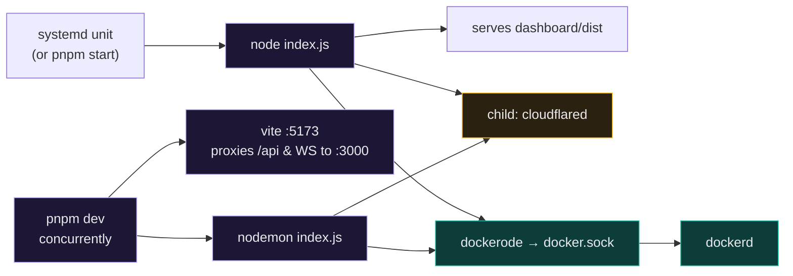
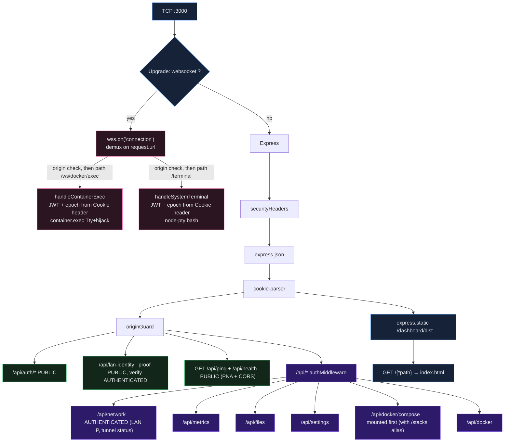
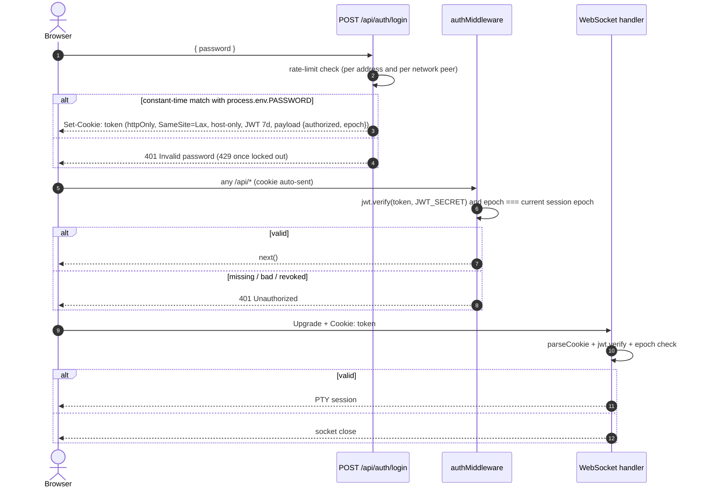
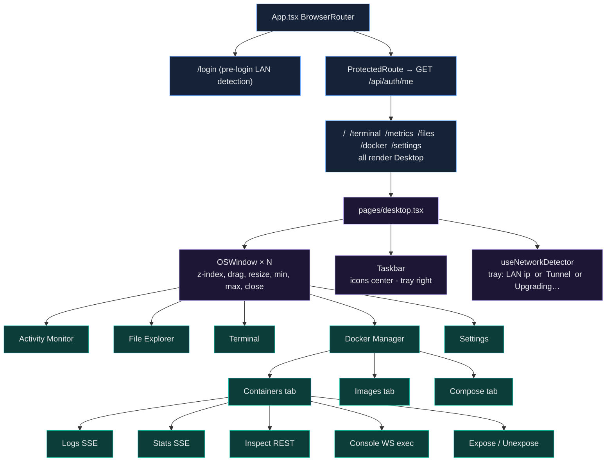
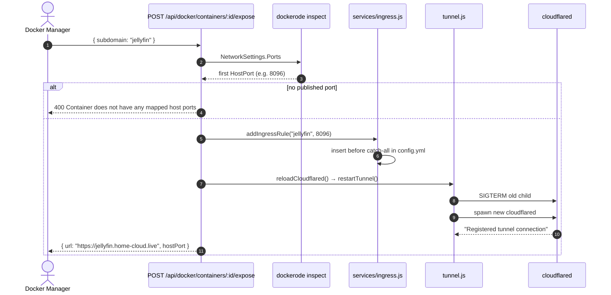
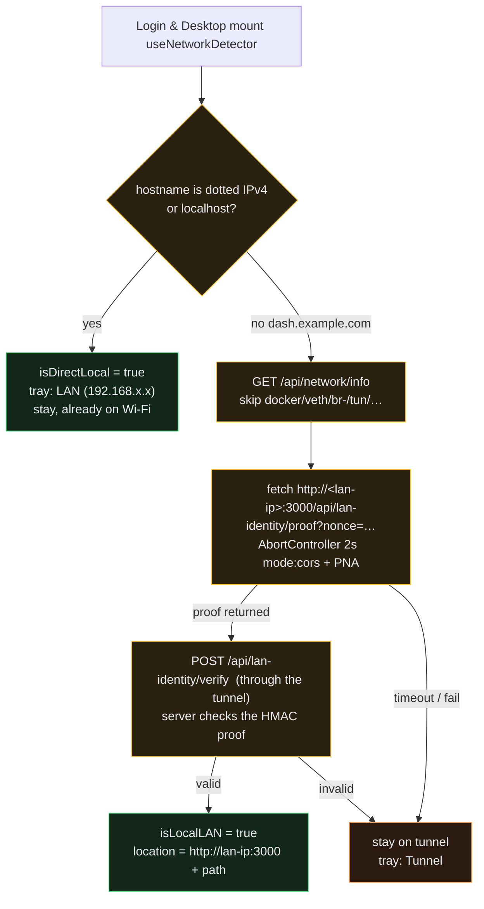

# Home Cloud — System Design

This is the as-built architecture of the running system. Every box, port, and path below maps to code in `agent/`, `dashboard/`, `setup.sh`, or the systemd unit. Roadmap items that are **not** shipped (App Store, noVNC, Cloudflare DNS API, SIGHUP reload) are called out separately and do not appear as live components.

---

## 1. What the system is

Home Cloud turns a spare Linux PC into a remotely managed server. The spare PC sits behind home NAT / CGNAT (typical of Indian ISPs). It cannot accept inbound connections, so it opens one **outbound** Cloudflare Tunnel. A browser anywhere then reaches a Web-OS control plane over HTTPS, and optionally reaches installed Docker apps on their own subdomains.

```
Control plane  =  dash.home-cloud.live   →  Agent :3000  (dashboard + API + WebSocket)
Data plane     =  <app>.home-cloud.live  →  container host port  (the app's own UI)
```

Those two planes are different browser origins on purpose. Installed apps open in new tabs via `window.open()`, never in an iframe (`X-Frame-Options` would block them).

---

## 2. Whole-system architecture

Read this top-to-bottom. Traffic always originates from a browser. The home router never opens an inbound port.

```mermaid
%%{init: {
  "theme": "dark",
  "themeVariables": {
    "primaryColor": "#12261f",
    "primaryTextColor": "#e8eaed",
    "primaryBorderColor": "#2dd4bf",
    "lineColor": "#6b7385",
    "secondaryColor": "#1e1635",
    "tertiaryColor": "#152238",
    "fontSize": "13px"
  }
}}%%
flowchart TB
  classDef client fill:#152238,stroke:#60a5fa,color:#e8eaed
  classDef edge fill:#2a1a10,stroke:#fb923c,color:#e8eaed
  classDef host fill:#10141c,stroke:#2dd4bf,color:#e8eaed
  classDef agent fill:#1e1635,stroke:#c4b5fd,color:#e8eaed
  classDef docker fill:#0d3d38,stroke:#14b8a6,color:#e8eaed
  classDef os fill:#12261a,stroke:#4ade80,color:#e8eaed
  classDef auth fill:#2a1520,stroke:#f87171,color:#e8eaed
  classDef data fill:#2a2110,stroke:#fbbf24,color:#e8eaed

  subgraph WORLD["ANY DEVICE  ·  any browser  ·  anywhere"]
    direction TB
    BROWSER["React SPA  —  dashboard/src<br/>React 19 + Vite + TS + React Compiler"]
    LOGIN["/login<br/>POST /api/auth/login {password}"]
    SHELL["Desktop Shell  —  pages/desktop.tsx<br/>OSWindow · taskbar · ErrorBoundary per app"]
    AM["Activity Monitor<br/>EventSource /api/metrics"]
    FE["File Explorer<br/>axios /api/files/*"]
    TERM["Terminal<br/>WS  {ws|wss}://host/terminal"]
    DM["Docker Manager<br/>REST + SSE + WS exec"]
    SETAPP["Settings<br/>preferences · wallpaper · storage<br/>password · updates"]
    APPTAB["Data-plane tabs  window.open()<br/>https://&lt;sub&gt;.home-cloud.live"]
    NET["useNetworkDetector<br/>GET /api/network/info<br/>keyed LAN proof → LAN redirect"]

    BROWSER --> LOGIN
    LOGIN --> SHELL
    SHELL --> AM & FE & TERM & DM & SETAPP & NET
    DM -.->|"Open exposed app"| APPTAB
  end

  subgraph CF["CLOUDFLARE EDGE  ·  public HTTPS, TLS terminated here"]
    direction LR
    DNS["DNS zone  home-cloud.live<br/>dash.home-cloud.live<br/>*.home-cloud.live"]
    TUN["Named tunnel  home-cloud<br/>&lt;tunnel-id&gt;.cfargotunnel.com"]
    ING["Ingress match on Host header<br/>dash → :3000<br/>jellyfin → :8096<br/>&lt;sub&gt; → :&lt;hostPort&gt;<br/>else → http_status:404"]
    DNS --> TUN --> ING
  end

  subgraph PC["SPARE LINUX PC  ·  always-on  ·  lid closed  ·  systemd service as your user"]
    direction TB

    subgraph CFD["cloudflared  —  child of the Agent"]
      TJS["tunnel.js<br/>spawn cloudflared tunnel --config<br/>$HOME/.cloudflared/config.yml<br/>run home-cloud"]
      CFG["~/.cloudflared/config.yml<br/>credentials JSON"]
      REL["reload = restartTunnel()<br/>SIGTERM old child + respawn<br/>NOT SIGHUP"]
    end

    subgraph AGENT["Node.js Agent  ·  Express v5 + ws  ·  :3000  ·  CommonJS"]
      HTTP["http.createServer(app)"]
      WSS["ws.WebSocketServer({ server })<br/>same port, upgrade event"]
      PIPE["1. shutdown guard · securityHeaders · express.json · cookie-parser · originGuard<br/>2. /api/auth, /api/lan-identity, /api/health, /api/ping public<br/>3. /api/* JWT + session-epoch middleware<br/>4. network · metrics · files · settings · compose · docker<br/>5. express.static ../dashboard/dist<br/>6. GET /{*path} → index.html"]
      AUTH["routes/auth.js + middleware/auth.js<br/>jwt 7d · httpOnly cookie · session epoch<br/>login rate limits"]
      MET["routes/metrics.js<br/>SSE every 2s + :heartbeat 15s"]
      FILES["routes/file.js<br/>$HOME, /mnt, /media,<br/>/run/media, /srv, custom paths<br/>/proc /sys /dev blocked"]
      DOCK["routes/docker.js<br/>dockerode → Docker Engine"]
      CMP["routes/compose.js<br/>~/.home-cloud/compose/&lt;name&gt; (legacy stacks aliased)"]
      NETR["routes/network.js<br/>os.networkInterfaces() LAN IP · tunnel status"]
      SET["routes/settings.js<br/>preferences · wallpaper · storage scope<br/>password · update"]
      LANID["routes/lanIdentity.js<br/>keyed LAN proof (HMAC)"]
      UPD["services/updateManager.js<br/>git release-tag update + rollback"]
      INGS["services/ingress.js<br/>js-yaml edit config.yml"]
      PTYH["sockets/terminal.js<br/>node-pty bash · persistent sessions"]
      PTYC["sockets/containerExec.js<br/>docker exec PTY"]

      HTTP --- WSS
      HTTP --> PIPE
      PIPE --> AUTH & MET & FILES & DOCK & CMP & NETR & SET & LANID
      DOCK --> INGS
      SET --> UPD
      WSS -->|"path /ws/docker/exec"| PTYC
      WSS -->|"path /terminal"| PTYH
    end

    subgraph HOS["Host OS interfaces"]
      SOCK["/var/run/docker.sock"]
      FS["Filesystem<br/>BASE_DIR + multer + EXDEV fallback"]
      SI["systeminformation<br/>CPU · mem · disk"]
      SH["real PTY  isatty()=true<br/>cwd=$HOME  TERM=xterm-256color"]
    end

    subgraph DE["Docker Engine"]
      CTR["Containers  isolated FS + PortBindings"]
      IMG["Images  pull / prune / delete / run"]
      CPJ["Compose projects<br/>label com.docker.compose.project"]
    end

    TJS --> CFG
    INGS --> REL
    REL --> TJS
    DOCK --> SOCK
    CMP --> SOCK
    PTYC --> SOCK
    MET --> SI
    FILES --> FS
    PTYH --> SH
    SOCK --> CTR & IMG & CPJ
  end

  BROWSER -->|"HTTPS / WSS"| DNS
  APPTAB -->|"HTTPS Host: &lt;sub&gt;.home-cloud.live"| DNS
  ING -->|"outbound tunnel only"| TJS
  TJS -->|"localhost:3000 HTTP+WS"| HTTP
  TJS -->|"localhost:&lt;hostPort&gt;"| CTR

  class BROWSER,LOGIN,SHELL,AM,FE,TERM,DM,SETAPP,APPTAB,NET client
  class DNS,TUN,ING edge
  class TJS,CFG,REL edge
  class HTTP,WSS,PIPE,MET,FILES,DOCK,CMP,NETR,SET,LANID,UPD,INGS,PTYH,PTYC agent
  class AUTH auth
  class SOCK,FS,SI,SH os
  class CTR,IMG,CPJ docker
```



### Physical path of a request

```
┌──────────────┐   HTTPS / WSS    ┌─────────────────────┐   outbound QUIC/HTTP2    ┌──────────────────────────┐
│   Browser    │ ───────────────► │  Cloudflare Edge    │ ◄────────────────────── │  cloudflared on spare PC │
│  any device  │ ◄─────────────── │  TLS + Host route   │                         │  child of Agent          │
└──────────────┘                  └──────────┬──────────┘                         └────────────┬─────────────┘
                                             │ Host: dash.home-cloud.live                      │
                                             │ Host: jellyfin.home-cloud.live                  ▼
                                             │                                                 ┌──────────────────────────┐
                                             │                                    localhost:3000│  Agent  Express + ws     │
                                             │                                    localhost:8096│  Docker published ports  │
                                             └────────────────────────────────────────────────►└──────────────────────────┘
```

CGNAT means the right-hand side can only *leave* the house. Cloudflare flips the direction: the PC dials out, then Cloudflare relays the browser in.

---

## 3. Repo and process layout

pnpm workspace with three packages: `agent`, `dashboard`, and `landing` (the public site and
docs, deployed separately and not part of the running product).

```
home_cloud/
├── package.json                 concurrently: agent + dashboard
├── pnpm-workspace.yaml          agent, dashboard, landing
├── setup.sh                     installer: prerequisites, build, tunnel, systemd unit
├── home-cloud.service.template  systemd unit (runs as your user, never root)
│
├── agent/                       CommonJS  —  no "type": "module"
│   ├── index.js                 HTTP + WS server, route mount order, graceful shutdown
│   ├── config.js                PORT, BASE_DIR, CF_DOMAIN, secret checks
│   ├── paths.js                 allowed file roots and scope checks
│   ├── tunnel.js                spawn / restart cloudflared, retry supervisor
│   ├── middleware/
│   │   ├── auth.js              jwt.verify + session-epoch check
│   │   ├── origin.js            originGuard: binds cookie calls to the serving host
│   │   └── securityHeaders.js   X-Frame-Options, frame-ancestors, nosniff
│   ├── services/
│   │   ├── ingress.js           read/write ~/.cloudflared/config.yml
│   │   ├── preferences.js       preferences.json, wallpaper, session epoch
│   │   ├── sessionStreams.js    closes SSE/streams when a session is revoked
│   │   └── updateManager.js     release check, apply, rollback
│   ├── routes/
│   │   ├── auth.js              login, logout, logout-all, me
│   │   ├── lanIdentity.js       keyed LAN proof endpoints
│   │   ├── network.js           info (LAN IP), tunnel status
│   │   ├── metrics.js           SSE
│   │   ├── file.js              CRUD + search + drives
│   │   ├── settings.js          preferences, wallpaper, storage, password, update
│   │   ├── docker.js            containers, images, expose
│   │   └── compose.js           compose deploy / start / stop / logs (also at /stacks)
│   └── sockets/
│       ├── terminal.js          host bash via node-pty, persistent sessions
│       └── containerExec.js     docker exec bash-or-sh
│
├── dashboard/                   ESM  —  React 19 + Vite 8 + TS
│   └── src/
│       ├── App.tsx              BrowserRouter routes
│       ├── hooks/               useNetworkDetector, useSystemMetrics, useWallpaper, useIsMobile
│       ├── components/
│       │   ├── ProtectedRoute.tsx     GET /api/auth/me
│       │   ├── OSWindow.tsx           drag / resize / min / max / close
│       │   ├── DesktopMetricWidget.tsx
│       │   └── apps/
│       │       ├── SystemMonitorApp.tsx
│       │       ├── TerminalApp.tsx
│       │       ├── DockerApp.tsx
│       │       ├── ContainerConsoleTab.tsx
│       │       └── SettingsApp.tsx
│       └── pages/
│           ├── login.tsx
│           ├── desktop.tsx            Web-OS shell + taskbar
│           ├── files.tsx              File Explorer window body
│           └── metrics.tsx
│
└── landing/                     Astro + Starlight: home-cloud.live site and /docs
```

### Runtime topology



Production is one Node process on `:3000` that serves the built SPA, the API, and both WebSocket kinds. In production it runs as the `home-cloud.service` systemd unit under your own user, with `Restart=always` and a `SIGTERM` stop that triggers the graceful shutdown in 4.1. In dev, Vite serves the SPA on `:5173` and proxies `/api`, `/terminal`, and `/ws` to the Agent on `:3000`. The remote and LAN paths always go through the Agent.

### Install, service, and remote SSH

`setup.sh` is a plain bash installer, pinned to a release tag. It:

- installs or reuses Node.js (`>= 22.23.4` with corepack; otherwise a checksum-verified private Node.js under `/opt/home-cloud`) and Docker Engine with the Compose plugin
- pins pnpm and downloads `cloudflared` as a SHA-256-verified release asset (no piped install scripts)
- builds the dashboard, writes the agent's `.env` (password and `JWT_SECRET`), and creates the Cloudflare tunnel and the `dash.<domain>` DNS record (and `ssh.<domain>` when SSH is enabled)
- renders `home-cloud.service` to run as your user (it refuses to render `User=root`) with `SupplementaryGroups=docker`
- keeps an interruption-safe journal and lock in `~/.local/state/home-cloud`, so an interrupted run can be repeated

Unless `--skip-ssh` is passed, it also enables the host's OpenSSH server and publishes `ssh.<domain>` through the same tunnel (key-only for tunnel connections). `dash` and `ssh` are reserved hostnames, and ports 22 and 3001 cannot be exposed or removed from the dashboard (`services/ingress.js`).

---

## 4. Agent internals

### 4.1 Single-port HTTP + WebSocket

`agent/index.js` creates one `http.Server`, then hangs `ws.WebSocketServer({ server, maxPayload: 1 MiB })` on it. Cloudflare therefore only needs one ingress target for the control plane: `http://localhost:3000`.

Every accepted WebSocket gets an `error` listener immediately, and handshake errors are logged and the socket destroyed, so a malformed frame cannot crash the process. After that, the connection is checked against the origin policy and routed by exact path: `/ws/docker/exec` goes to container exec, `/terminal` goes to the host terminal, and anything else is closed.



Mount order is load-bearing:

| Order | Mount | Why it is there |
|------:|-------|-----------------|
| 1 | Shutdown guard, `securityHeaders`, `express.json`, `cookie-parser`, `originGuard` | Refuse new requests while draining, send anti-framing headers, parse request data, and bind cookie-authenticated calls to the host that served them |
| 2 | `/api/auth` | Public login; logout and logout-all require a session; `/me` validates the session cookie |
| 3 | `/api/lan-identity` | `GET /proof` is public (CORS and Private Network Access) so the browser can probe the LAN; `POST /verify` is authenticated |
| 4 | `/api/ping`, `/api/health` | Public reachability and liveness probes with CORS `*` and Private Network Access (PNA) |
| 5 | `/api` + `authMiddleware` | All subsequent API routes require a valid JWT whose epoch matches the current session epoch |
| 6 | `/api/me`, `/api/network`, `/api/metrics`, `/api/files`, `/api/settings` | Authenticated session info, network discovery, and feature routers |
| 7 | `/api/docker/compose` (and its `/api/docker/stacks` alias) **before** `/api/docker` | Otherwise `:id` on docker would swallow `compose` |
| 8 | `/api/docker` | Authenticated Docker routes |
| 9 | `express.static(dashboard/dist)` | Built SPA assets |
| 10 | `GET /{*path}` → `index.html` | React Router deep links (`/docker`, `/files`, …) |

`securityHeaders` sets `X-Frame-Options: SAMEORIGIN`, `Content-Security-Policy: frame-ancestors 'self'`, and `X-Content-Type-Options: nosniff`, so a sibling subdomain cannot frame the dashboard.

### Graceful shutdown

On `SIGTERM` or `SIGINT` the Agent stops accepting new connections, closes idle keep-alive connections, closes every WebSocket with code 1001, terminates all host terminal PTYs, stops `cloudflared`, and exits. A 10-second timer forces the exit if anything hangs. Startup does the reverse: the HTTP server listens immediately so the LAN address works at once, and `startTunnelWithRetry()` brings the tunnel up in the background with retries.

### 4.2 Auth

Single shared passcode. One JWT. No users table.



- **Cookie:** `httpOnly` keeps the token out of JS (XSS). `SameSite=Lax` and no `Domain` attribute make it host-only, so sibling subdomains never receive it. `Secure` is set when the request arrived over HTTPS (directly or via `X-Forwarded-Proto`) and left off over plain HTTP on the LAN, so both the tunnel and local-IP sessions can store the cookie.
- **Login limits:** five failures within a minute lock that address out for five minutes. A separate aggregate limit of 30 failures per minute applies per network peer, so rotating forwarded headers cannot reset the budget. The password comparison is constant-time.
- **Revocation:** every JWT carries the **session epoch** (stored in `preferences.json`) it was issued under. Logging out, "log out everywhere", and changing the password all increment the epoch, which invalidates every existing token. Open SSE streams, WebSockets, and detached terminal sessions are closed too (`services/sessionStreams.js` and the sockets re-check the epoch).
- **Origin binding:** `originGuard` requires every state-changing request (POST, PUT, PATCH, DELETE) to carry an `Origin` or `Referer` that matches the host that served the page, and rejects any cookie-authenticated `/api` call marked `Sec-Fetch-Site: cross-site`, so a sibling subdomain cannot drive the dashboard. WebSocket upgrades go through the same origin check.

`ProtectedRoute` does **not** parse the cookie in JS. It queries `GET /api/auth/me`. 200 means the server verified the cookie JWT; 401 sends the user to `/login`.

### 4.3 API surface

**Auth** (`routes/auth.js`)

| Method | Path | Notes |
|--------|------|-------|
| POST | `/api/auth/login` | Validates passcode, signs JWT, sets `token` cookie |
| GET | `/api/auth/me` | Validates the session cookie and returns `{ authorized: true, user }` |
| POST | `/api/auth/logout` | Authenticated. Increments the session epoch (revoking every session) and clears the cookie |
| POST | `/api/auth/logout-all` | Same effect as logout; the explicit "log out everywhere" action |

**Health / network**

| Method | Path | Notes |
|--------|------|-------|
| GET | `/api/health` | Public. Returns `{ status: "ok", shuttingDown }`. CORS `*`, Private Network Access (PNA) header |
| GET | `/api/ping` | Public. Returns `{ status: "ok" }` |
| GET | `/api/network/info` | Authenticated. First non-virtual IPv4, the listen port (`process.env.PORT`, default `3000`), base dir, `CF_DOMAIN`, tunnel status, and the service user |
| GET | `/api/network/tunnel` | Authenticated. Tunnel status only |
| GET | `/api/lan-identity/proof?nonce=` | Public (CORS + PNA). Returns an HMAC of the nonce keyed from `JWT_SECRET`. Refused for requests that arrived through the tunnel (loopback peer or `CF-*` headers) |
| POST | `/api/lan-identity/verify` | Authenticated. Checks that a proof fetched from a LAN address is valid for this install |
| GET | `/api/me` | Authenticated. `{ authorized: true, user }` |

**Metrics** (`routes/metrics.js`)

| Method | Path | Notes |
|--------|------|-------|
| GET | `/api/metrics` | SSE. `retry: 5000`. Body every 2s from `systeminformation` (`currentLoad`, `mem`, `fsSize`). Comment `: heartbeat` every 15s so Cloudflare does not idle-kill the stream. |

**Files** (`routes/file.js`) — allowed roots are `$HOME`, `/mnt`, `/media`, `/run/media`, `/srv`, and custom paths. `/proc`, `/sys`, and `/dev` stay blocked.

| Method | Path | Notes |
|--------|------|-------|
| GET | `/api/files` | List directory |
| GET | `/api/files/download` | Stream file |
| GET | `/api/files/view` | Attachment, except `.png`, `.jpg`, `.jpeg`, `.webp`, and `.gif`. Sets `X-Content-Type-Options: nosniff`. HTML and SVG are not inline. |
| GET | `/api/files/drives` | `systeminformation` mounts |
| GET | `/api/files/search` | `child_process.spawn` |
| POST | `/api/files/upload` | `multer` to resolved dest |
| POST | `/api/files/copy` | |
| POST | `/api/files/folder` | mkdir |
| POST | `/api/files/file` | touch |
| PATCH | `/api/files/rename` | |
| PATCH | `/api/files/move` | `rename`, or `cp`+`rm` on `EXDEV` |
| DELETE | `/api/files/delete` | |

Requested paths are canonicalized and must stay inside those roots. `/proc`, `/sys`, and `/dev` stay blocked in every mode, including full system root.

**Docker containers / images** (`routes/docker.js`) — `dockerode` default socket

| Method | Path | Notes |
|--------|------|-------|
| GET | `/api/docker/containers` | `listContainers({all:true})` + `exposedRule` from ingress YAML |
| POST | `/api/docker/containers/create` | image, name, env, ports, volumes, restartPolicy; then start |
| POST | `/api/docker/containers/:id/start` | 304 → 409 already running |
| POST | `/api/docker/containers/:id/stop` | stop; ingress rules are left in place so a restart keeps its route |
| POST | `/api/docker/containers/:id/restart` | |
| DELETE | `/api/docker/containers/:id/delete` | remove + ingress cleanup; 409 if still running |
| GET | `/api/docker/containers/:id/stats` | SSE `container.stats({stream:true})` |
| GET | `/api/docker/containers/:id/inspect` | full inspect JSON |
| GET | `/api/docker/containers/:id/logs` | SSE follow, tail 200, timestamps, TTY demux |
| GET | `/api/docker/containers/:id/logs/download` | attachment |
| POST | `/api/docker/containers/:id/expose` | `{subdomain}` → first HostPort → YAML → restart tunnel |
| POST | `/api/docker/containers/:id/unexpose` | `{subdomain}` → drop rule → restart |
| GET | `/api/docker/images` | |
| POST | `/api/docker/images/pull` | `{image}`; streams layer progress as SSE in the response. A `GET` returns 405 |
| DELETE | `/api/docker/images/:id` | 409 if in use |
| POST | `/api/docker/images/prune` | |

**Compose Projects** (`routes/compose.js`) — disk + native Docker Compose CLI

| Method | Path | Notes |
|--------|------|-------|
| GET | `/api/docker/compose` | folders in `~/.home-cloud/compose` ∪ compose-project labels (legacy `/api/docker/stacks` aliased) |
| GET | `/api/docker/compose/:name` | YAML + member containers |
| POST | `/api/docker/compose/deploy` (also `/:name/deploy`) | write YAML, `docker compose -p <name> up -d --remove-orphans`, SSE lines |
| POST | `/api/docker/compose/:name/start` | `docker compose -p <name> start` (with `up -d` fallback) |
| POST | `/api/docker/compose/:name/stop` | `docker compose -p <name> stop` (non-destructive) |
| DELETE | `/api/docker/compose/:name` | `docker compose -p <name> down -v --remove-orphans` + `rm -rf` compose dir |
| GET | `/api/docker/compose/:name/logs` | SSE `docker compose logs -f --tail=200` |

**Settings** (`routes/settings.js`) — state lives in `preferences.json` under `$HOME_CLOUD_CONFIG_DIR`, `$XDG_CONFIG_HOME/home-cloud`, or `~/.config/home-cloud`

| Method | Path | Notes |
|--------|------|-------|
| GET / PUT | `/api/settings/preferences` | Read and update preferences |
| GET / POST / DELETE | `/api/settings/wallpaper` | Custom wallpaper file stored beside the preferences |
| GET / PUT | `/api/settings/storage` | `allowSystemRoot` and custom storage paths that widen the file-route scope |
| POST | `/api/settings/password` | Change the password; revokes every session |
| GET | `/api/settings/update/status` | Current version, latest release (cached 24h), `updateAvailable` |
| POST | `/api/settings/update/check` | Force a fresh release check |
| POST | `/api/settings/update/apply` | Start the update pipeline (see 6.6) |
| GET | `/api/settings/update/progress` | SSE stream of update stages |

---

## 5. Dashboard internals

The dashboard is a single-page Web OS, not a multi-page admin site.



Deep links (`/docker`, `/files`, …) only decide which `OSWindow` opens. The shell is always `Desktop`. Each window is wrapped in an `ErrorBoundary` so one crash does not blank the desktop. Window apps are code-split and lazy-loaded (`utils/windowAppRegistry.ts`). On phones (`useIsMobile`) the shell swaps the dock for a bottom navigation bar.

Transport choices on the client:

| Surface | Transport | Why |
|---------|-----------|-----|
| Login / files / docker actions | `fetch` / `axios` (cookies included, same origin) | Request/response |
| Metrics, container stats/logs, compose deploy/logs, update progress | `EventSource` | Server → client stream, auto-retry |
| Image pull | `fetch` POST, streamed response body | Pull is POST-only (a body and no cross-site GET) |
| Host terminal | `WebSocket` `//${host}/terminal?sessionId=` | Bidirectional bytes; the `sessionId` lets a reconnect reattach to the same PTY |
| Container console | `WebSocket` `//${host}/ws/docker/exec?containerId=` | Bidirectional + JSON `{type:"resize"}` |

---

## 6. Critical data flows

### 6.1 Host terminal

```
xterm.js keystroke
    → WebSocket  /terminal?sessionId=<id>
    → sockets/terminal.js  origin check, jwt.verify + epoch
    → session lookup or create (max 16)  →  node-pty.write → bash
    → PTY onData → scrollback buffer (5 MB) + broadcast to attached sockets
    → xterm.write
```

A real PTY is mandatory. `child_process.spawn` makes `isatty()` false; vim, htop, and fzf then misbehave.

Sessions are decoupled from sockets. If the browser tab, the tunnel, or the network drops, the PTY keeps running. The client reconnects with backoff and the same `sessionId`, and the Agent replays the scrollback buffer so the screen comes back. When 16 sessions exist, a detached one is evicted to make room. Logging out, logging out everywhere, or changing the password terminates sessions, and graceful shutdown closes them all so no orphaned `bash` survives.

### 6.2 Metrics

```
systeminformation every 2s
    → res.write("data: "+JSON+"\n\n")
    → EventSource.onmessage
    → MeterBar + 60-point SparklineChart

every 15s: res.write(": heartbeat\n\n")
    → EventSource ignores  (SSE comment)
    → Cloudflare idle timer resets
```

SSE over long-poll HTTP because: proxies buffer ordinary responses, Cloudflare kills idle HTTP, and SSE already has framing + `retry:`.

### 6.3 Expose a container (control plane → data plane)

This is the glue between Docker and Cloudflare. There is **no** Cloudflare DNS API call in the running agent, and there is **no** `SIGHUP` reload. The code writes ingress YAML and restarts `cloudflared`. `CF_DOMAIN` has no default; if it is unset, ingress does not write config. Names such as `home-cloud.live` in the diagrams are examples, not the agent's default domain. The installer publishes DNS only for `dash.$DOMAIN`. Other names need a wildcard CNAME.



Container deletion (`DELETE /api/docker/containers/:id/delete`) walks published ports: `await removeIngressByPort(hostPort)` then reloads cloudflared. Temporary container `stop` intentionally leaves ingress rules intact so restarting the container preserves domain routing.

Ingress file shape the agent actually edits:

```yaml
tunnel: <tunnel-id>
credentials-file: /home/<user>/.cloudflared/<tunnel-id>.json
ingress:
  - hostname: dash.home-cloud.live
    service: http://localhost:3000
  - hostname: jellyfin.home-cloud.live    # inserted by addIngressRule
    service: http://localhost:8096
  - service: http_status:404              # MUST stay last
```

`getIngressRules()` skips `dash.${CF_DOMAIN}` so the dashboard hostname is never treated as an "exposed app".

### 6.4 Compose project deploy

```
POST /api/docker/compose/deploy { name, yaml }
    → mkdir ~/.home-cloud/compose/<name>/
    → write docker-compose.yml
    → spawn: docker compose -f … -p <name> up -d --remove-orphans
    → each stdout/stderr chunk  →  SSE  data: {"text":"…"}
    → close: data: {"status":"success"|"failed","exitCode":N}
```

List state is derived, not stored: compose project label `com.docker.compose.project` plus whatever folders exist on disk → `running` / `partial` / `stopped` / `uncreated`.

### 6.5 LAN vs tunnel (client-side, not DNS)

Split-horizon DNS is not shipped. What is shipped is a **page-origin redirect**, and it only fires after the machine on the LAN proves it is the same install.



The nonce is random per check. The LAN host can only return a valid proof if it holds this install's key (derived from `JWT_SECRET`), so a stranger's device on the same subnet cannot hijack the redirect. The proof endpoint refuses requests that came through the tunnel, so the proof cannot be relayed via the public hostname.

When the redirect succeeds, the browser talks to the Agent at LAN round-trip times and never hairpins through Cloudflare. When it fails (phone on 4G, LAN IP unreachable, or proof invalid), the Cloudflare path is unchanged. Pre-login detection runs on `login.tsx` so users on home Wi-Fi are redirected to the LAN origin *before* signing in, avoiding a double login. Adding `?stay_remote` to the URL skips the check.

### 6.6 Self-update

Settings checks the latest GitHub release (cached for 24 hours) and shows an amber dot on the dock when a newer version exists. "Update" calls `POST /api/settings/update/apply` and streams progress over SSE:

```
preflight   git status clean, no merge in progress, > 500 MB free disk
fetch       capture current commit for rollback; fetch tags; check out the release tag
            (only tags advertised by origin and matching vX.Y.Z are accepted)
install     pnpm install --frozen-lockfile  (no unpinned fallback)
build       pnpm --filter dashboard build; verify dist/index.html exists
restart     schedule a service restart ~2 seconds later
```

If any stage fails, the Agent checks the previous commit back out ("rollback"). Limits: rollback restores the git revision only; it does not rebuild the old `dashboard/dist` by itself. The installer (`setup.sh`) installs the latest published release, never unreleased `main`.

---

## 7. Trust boundaries and isolation

```
Internet
   │  TLS at Cloudflare  ·  no open router ports
   ▼
Cloudflare Edge
   │  Host-based ingress  ·  dash vs app hostnames
   ▼
cloudflared  (unprivileged child, outbound only)
   │  localhost only
   ▼
Agent :3000
   │  securityHeaders · originGuard · login rate limits
   │  JWT cookie + session epoch on /api/* and both WS handlers
   │  file routes: $HOME, /mnt, /media, /run/media, /srv, custom paths
   │  docker group → docker.sock   ←  this is root-equivalent
   ▼
Docker Engine
   │  per-container FS, PortBindings, compose project labels
   ▼
App containers   (data plane, own origin)
```

Implications:

- Anyone with the passcode has a host shell (`node-pty` as the Agent's user) and Docker (effectively host root). This is intentional for a single-owner spare PC.
- File routes allow `$HOME` plus `/mnt`, `/media`, `/run/media`, `/srv`, and custom paths. `/proc`, `/sys`, and `/dev` stay blocked. The terminal is not jailed the same way.
- Each exposed app is a separate origin (`jellyfin.home-cloud.live` vs `dash.home-cloud.live`), so cookies and storage do not leak across apps.
- Restarting the tunnel to apply ingress drops in-flight SSE/WS on `dash` for a moment. That is the current reload strategy. Terminal sessions survive it because they are decoupled from the socket (see 6.1).
- Revocation is immediate: bumping the session epoch invalidates every cookie and closes open streams and terminals. The password, `JWT_SECRET`, and the epoch are the whole trust root, and the password grants a host shell and the Docker socket, so it should be strong.
- Sibling hostnames cannot reach the dashboard's session: the cookie is host-only, `originGuard` binds state-changing requests to the serving host, and `frame-ancestors 'self'` blocks framing.

---

## 8. Key decisions (as built)

| Decision | Rationale |
|----------|-----------|
| Cloudflare Tunnel, not a VPS or port-forward | CGNAT. The PC can only dial out. |
| One `cloudflared`, many hostnames | One process, one config, Host-header routing. |
| Docker for apps, Cloudflare for reachability | Lifecycle ≠ ingress. Agent orchestrates both. |
| Apps in new tabs, never iframe | Cross-origin `X-Frame-Options`. Control plane vs data plane. |
| Single port 3000 for HTTP + WS | One ingress target. `ws` hijacks `upgrade`. |
| SSE for metrics/logs/pull/deploy, WS for shells | One-way stream vs bidirectional PTY. |
| **Rule:** every streaming response is SSE (`Content-Type: text/event-stream`) or a WebSocket | `cloudflared` buffers other chunked HTTP responses, so a plain chunked stream arrives all at once through the tunnel. Keep SSE heartbeats (`: heartbeat`) on long streams so Cloudflare does not idle them out. |
| JWT in an `httpOnly`, host-only cookie with a session epoch | Auto-sent on XHR and WS handshake. Not readable by JS. Bumping the epoch revokes everything at once. |
| CommonJS agent | `node-pty` / `dockerode` native `.node` bindings want `require()`. |
| `restartTunnel()` instead of SIGHUP | What `services/ingress.js` actually calls today. |
| No Cloudflare DNS API in the agent | Expose only mutates local YAML. Wildcard/CNAME is out-of-band. |
| Client LAN probe + keyed proof, not split-horizon DNS | Works without a local DNS server. The redirect needs a valid HMAC proof, and a 2s timeout fails open to the tunnel. |
| Persistent terminal sessions | The PTY outlives the socket, so a dropped tunnel or closed tab does not kill the shell. |
| Self-update from release tags | Update only to advertised `vX.Y.Z` tags with a frozen lockfile, with git rollback on failure. |
| pnpm workspaces + concurrently | Three packages (`agent`, `dashboard`, `landing`). No Turborepo. |
| Custom Docker UI, not Portainer iframe | Same origin, same auth, same windowing shell. |

---

## 9. What is not in this diagram

None of these exist as running processes. The planned ones are in [`future_roadmap.md`](future_roadmap.md):

| Item | Status |
|------|--------|
| App Store / one-click catalog | Not built |
| noVNC / remote desktop | Not built |
| Cloudflare REST CNAME create on expose | **Not** in `ingress.js` |
| SIGHUP zero-downtime reload | Not built; code respawns the process |
| Multi-user / RBAC | Single passcode |
| Volume backup, container crash watchdog | Planned (`future_roadmap.md`) |

Known debts are tracked in [`TECHNICAL_DEBT.md`](TECHNICAL_DEBT.md).

---

## 10. How to read this against the code

Start at `agent/index.js`. That file is the entire control-plane process: middleware order, router mounts, WebSocket demux, static SPA, tunnel boot. Then:

1. `tunnel.js` + `services/ingress.js` — how the machine becomes reachable.
2. `routes/*.js` — what the dashboard can do.
3. `sockets/*.js` — the two PTY paths.
4. `dashboard/src/App.tsx` → `pages/desktop.tsx` — the only UI shell.
5. `hooks/useNetworkDetector.ts` — the LAN shortcut around the tunnel.
