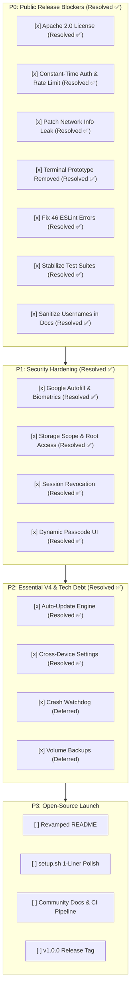

# Home Cloud — Open-Source Launch Roadmap & Pre-Release Checklist

This document catalogs all prerequisite architectural fixes, security hardening, feature completions, test suite stabilizations, and repository polishing required before making **Home Cloud** publicly accessible as an open-source project on GitHub.

---

## 📊 Release Readiness Scorecard

| Category | Status | Blocking Severity | Key Issues / Gaps |
| :--- | :---: | :---: | :--- |
| **P0: Public Release Blockers** | ✅ Ready / Resolved | **NONE** | All 7 hard gates resolved: License applied, constant-time auth & rate limiting, network info disclosure patched, dead terminal removed, 46 ESLint violations fixed, test suites passing (93/93 E2E tests), docs sanitized. |
| **P1: Security & Privilege Boundaries** | ✅ Ready / Resolved (4/4 Resolved) | **NONE** | All 4 security gates resolved: Storage Scope & System Root Access, Google Autofill Biometrics, Server-Side Session Revocation / Token Epoch, and Dynamic Passcode Management UI & Endpoint. (Chunked uploads deferred to final phase in TECHNICAL_DEBT.md). |
| **P2: Essential V4 & Tech Debt Milestones** | ✅ Ready / Resolved (2/2 Resolved for 1.0) | **NONE** | Auto-update engine and cross-device settings persistence resolved ✅. Container crash watchdog and automated volume backups deferred to post-1.0 roadmap in [`docs/future_roadmap.md`](future_roadmap.md). (File Explorer usability & search sits in TECHNICAL_DEBT.md). |
| **P3: Open-Source Polish & Governance** | 📝 Planned | **LOW** | 1-line curl installer, modernized `README.md`, `CONTRIBUTING.md`, `SECURITY.md`, GitHub Actions CI. |

---

## 📋 Master Launch Checklist

### P0: Public Release Blockers (Hard Gates)
- [x] **1. Open-Source License Applied** (Apache License 2.0)
- [x] **2. Constant-Time Authentication & Login Rate Limiting**
- [x] **3. Patch Unauthenticated Host Information Disclosure**
- [x] **4. Remove Dead & Hardcoded Standalone Terminal Prototype**
- [x] **5. Fix 46 ESLint Violations in Frontend**
- [x] **6. Stabilize Automated Test Suites**
- [x] **7. Sanitize Hardcoded Usernames & Example Domains in Docs**

### P1: Security & Privilege Boundary Hardening
- [x] **1. Google Autofill & Biometric Credential Support** (Resolved ✅)
- [x] **2. Multi-Drive Storage Scope & System Root Access Mode** (Resolved ✅)
- [x] **3. Server-Side Session Revocation & Token Epoch** (Resolved ✅)
- [x] **4. Dynamic Passcode Management UI & Endpoint** (Resolved ✅)

### P2: Essential V4 & Tech Debt Feature Additions
- [x] **1. One-Click Auto-Update Engine & Release Pipeline** (Resolved ✅)
- [x] **2. Cross-Device Settings & Personalization Persistence** (Resolved ✅)
- [x] **3. Container Crash Watchdog & Webhooks** (Deferred to Post-1.0 Roadmap 📋 — see [`docs/future_roadmap.md`](future_roadmap.md))
- [x] **4. Automated Volume & Database Backups** (Deferred to Post-1.0 Roadmap 📋 — see [`docs/future_roadmap.md`](future_roadmap.md))

### P3: Open-Source Distribution, Packaging & Developer Experience
- [ ] **1. 1-Command Automated Installer (`curl | bash`)**
- [ ] **2. Comprehensive `README.md` Revamp**
- [ ] **3. Open-Source Community Guidelines & Templates**
- [ ] **4. GitHub Actions CI/CD Pipeline**

---

## 🚨 Priority 0: Public Release Blockers (Hard Gates)

These items **must** be resolved before the repository visibility is changed to public. Neglecting any of these risks legal ambiguity, immediate credential vulnerability, or severe user onboarding failure.

- [x] **1. Open-Source License Applied (Resolved ✅)**
- [x] **2. Constant-Time Authentication & Login Rate Limiting (Resolved ✅)**
- [x] **3. Patch Unauthenticated Host Information Disclosure (Resolved ✅)**
- [x] **4. Remove Dead & Hardcoded Standalone Terminal Prototype (Resolved ✅)**
- [x] **5. Fix 46 ESLint Violations in Frontend (Resolved ✅)**
- [x] **6. Stabilize Automated Test Suites (Resolved ✅)**
- [x] **7. Sanitize Hardcoded Usernames & Example Domains in Docs (Resolved ✅)**

### 1. Open-Source License Applied (Resolved ✅)
* **Status**: [x] Resolved (Apache License, Version 2.0).
* **Verification**:
  * Verified [`LICENSE`](../LICENSE) exists in root with full Apache 2.0 terms and `Copyright 2026 Rudra Agrawal (Cypher0071)`.
  * Verified consistent SPDX identifier `"license": "Apache-2.0"` in root [`package.json`](../package.json#L13) and [`agent/package.json`](../agent/package.json#L12).
  * Tested and validated on both `Cypher-0071/siren` and `main` branches.

---

### 2. Constant-Time Authentication & Login Rate Limiting (Resolved ✅)
* **Status**: [x] Resolved.
* **Resolution**:
  * Implemented constant-time password comparison in [`agent/routes/auth.js`](../agent/routes/auth.js) using `crypto.timingSafeEqual` with SHA-256 pre-hashed buffers. Eliminates string comparison timing attacks and variable-length buffer exceptions.
  * Implemented an in-memory sliding window rate limiter and brute-force lockout:
    * 5 failed attempts within 60 seconds triggers a 5-minute temporary IP lockout.
    * Returns HTTP `429 Too Many Requests` with standard `Retry-After` header and remaining lockout seconds.
    * Extracts client IP accurately across reverse proxies and Cloudflare Tunnels (`cf-connecting-ip`, `x-forwarded-for`, `req.ip`).
    * Resets failed attempt counter immediately upon successful password authentication.
    * Unref'd background garbage collector evicts expired records every 5 minutes.
* **Verification**:
  * Validated with automated test suite in [`agent/tests/verify_auth.mjs`](../agent/tests/verify_auth.mjs). Verified exact match, character mismatch, length variance, non-string guards, multi-attempt lockout, retry headers, IP isolation, and post-login counter clearance.

---

### 3. Patch Unauthenticated Host Information Disclosure (Resolved ✅)
* **Status**: [x] Resolved.
* **Resolution**:
  * Moved `app.use("/api/network", require("./routes/network"))` after `app.use("/api", authMiddleware)` in [`agent/index.js`](../agent/index.js), ensuring `/api/network/info` and `/api/network/tunnel` strictly require an authenticated JWT cookie.
  * Implemented public, sanitized [`/api/ping`](../agent/index.js#L62-L73) endpoint with CORS (`Access-Control-Allow-Origin: *`) and W3C Private Network Access (`Access-Control-Allow-Private-Network: true`) returning strictly `{ status: "ok" }`.
  * Sanitized public `/api/health` to remove `tunnel` status leakage.
  * Enhanced [`dashboard/src/hooks/useNetworkDetector.ts`](../dashboard/src/hooks/useNetworkDetector.ts) to micro-ping `/api/ping`, support `localStorage` caching for returning users to enable pre-login LAN switching without credential loss, and export `resetNetworkDetectorCache()` to avoid in-memory singleton cache poisoning upon login.
  * Created automated test suite [`agent/tests/verify_network_security.mjs`](../agent/tests/verify_network_security.mjs) verifying unauthenticated blocking, PNA preflights, and authenticated access across 8 test cases.

---

### 4. Remove Dead & Hardcoded Standalone Terminal Prototype (Resolved ✅)
* **Status**: [x] Resolved.
* **Resolution**:
  * Deleted obsolete prototype file `dashboard/src/pages/terminal.tsx` which previously hardcoded `wss://home-cloud.live/terminal`.
  * Verified that routing in [`dashboard/src/App.tsx`](../dashboard/src/App.tsx) points `/terminal` directly to the production desktop workspace (`<ProtectedRoute><Desktop /></ProtectedRoute>`), which renders the full-featured [`TerminalApp`](../dashboard/src/components/apps/TerminalApp.tsx).
  * Verified frontend build via `pnpm --filter dashboard build` builds cleanly with 0 errors.

---

### 5. Fix 46 ESLint Violations in Frontend (Resolved ✅)
* **Status**: [x] Resolved.
* **Resolution**:
  * Refactored [`dashboard/src/pages/files.tsx`](../dashboard/src/pages/files.tsx):
    * Unexported helper `fetchDrives` to satisfy Vite fast-refresh rules.
    * Replaced all explicit `any` usages with typed interfaces (`BackendFileEntry`, `ApiResponseFiles`) and type-safe `catch (err: unknown)` handlers guarded with `axios.isAxiosError`.
    * Resolved React 19 `react-hooks/set-state-in-effect` violations by deferring synchronous effect updates out of the effect body via `setTimeout(..., 0)`.
    * Wrapped `handleCopy`, `handleCut`, and `handlePaste` in `useCallback` to satisfy `react-hooks/exhaustive-deps`.
  * Refactored [`dashboard/src/components/apps/DockerApp.tsx`](../dashboard/src/components/apps/DockerApp.tsx):
    * Added strict interfaces `DockerRawStats` and `DockerInspectData` to eliminate 25 `@typescript-eslint/no-explicit-any` errors in stats calculations, inspect data display, and error handlers.
    * Resolved 5 React 19 `react-hooks/set-state-in-effect` violations in highlight indexing, compose logs, polling, tab switching, and container logs streaming.
  * Refactored [`dashboard/src/components/apps/ContainerConsoleTab.tsx`](../dashboard/src/components/apps/ContainerConsoleTab.tsx) and [`dashboard/src/hooks/useNetworkDetector.ts`](../dashboard/src/hooks/useNetworkDetector.ts) to clean up unused catch bindings and synchronous effect state updates.
  * Verified: `pnpm --filter dashboard lint` and `pnpm --filter dashboard build` both pass cleanly with 0 errors and 0 warnings.

---

### 6. Stabilize Automated Test Suites (Resolved ✅)
* **Status**: [x] Resolved.
* **Resolution**:
  * Modernized test assertions in [`.agents/tests/terminal_e2e.test.mjs`](../.agents/tests/terminal_e2e.test.mjs) to match the production `TerminalApp.tsx` implementation:
    * `T1.28` & `T3.4`: Assert that toolbar Clear button sends `\x0c` (Ctrl+L) over socket for shell prompt redraw and retains terminal focus.
    * `T1.29`: Assert that Reconnect button updates status to connecting, invokes `connectSocket(term)`, and focuses terminal.
    * `T1.40`: Assert proper React 19 type safety with `ConnectionStatus` type alias.
    * `T2.24`: Assert that `socket.onerror` delegates retry/status to `socket.onclose` .
    * `T2.38`: Assert WebSocket endpoint targets `/terminal?sessionId=${encodeURIComponent(SESSION_ID)}`.
    * `T3.1` & `T3.5`: Assert font loading and ResizeObserver trigger `syncDimensions()` protected by try/catch for PTY fit and col/row synchronization.
  * Added unified `pnpm test` script in root [`package.json`](../package.json) running all 3 verification tiers (`test:dashboard`, `test:agent`, `test:e2e`).
  * Verified: All 93 terminal E2E tests pass (100%), and `pnpm test` exits cleanly with code 0 across all suites.

---

### 7. Sanitize Hardcoded Usernames & Example Domains in Docs (Resolved ✅)
* **Status**: [x] Resolved.
* **Resolution**:
  * Sanitized personal usernames (`rudra-unix`) to generic `/home/<user>` or `$HOME` across all documentation and configuration references in [`docs/SYSTEM_DESIGN.md`](SYSTEM_DESIGN.md), [`docs/CONTEXT.md`](CONTEXT.md), [`README.md`](../README.md), [`docs/TECHNICAL_DEBT.md`](TECHNICAL_DEBT.md), and `docs/learn/*.md` (`cloudflare_ingress_autowiring.md`, `cloudflare_tunnels.md`, `docker-concepts.md`, `docker.md`).
  * Sanitized specific Cloudflare Tunnel UUIDs (`43a28f80-7711-482a-a92c-567c1e5ba95c`) to generic `<tunnel-id>` across all architecture diagrams and guides.
  * Sanitized user privilege commands (`sudo usermod -aG docker rudra-unix`) to `$USER` / `<user>`.
  * Removed all absolute local machine links (`file:///home/rudra-unix/...`) across `docs/launch_changes.md` and `docs/TECHNICAL_DEBT.md`, converting them to clean relative repository links.

---

## 🔐 Priority 1: Security & Privilege Boundary Hardening

Production-grade self-hosted tools must withstand exposure to the open internet. The following security upgrades prevent host takeover and data leakage.

- [x] **1. Google Autofill & Biometric Credential Support (Resolved ✅)**
- [x] **2. Multi-Drive Storage Scope & System Root Access Mode (Resolved ✅)**
- [x] **3. Server-Side Session Revocation & Token Epoch (Resolved ✅)**
- [x] **4. Dynamic Passcode Management UI & Endpoint (Resolved ✅)**

### 1. Google Autofill & Biometric Credential Support (Resolved ✅)
* **Status**: [x] Resolved (`d4ac7f5` & `82b99d5`).
* **Resolution**:
  * Form Semantics & Identity Pairing in [`dashboard/src/pages/login.tsx`](../dashboard/src/pages/login.tsx):
    * Configured `<form>` with explicit `method="post"`, `action="/api/auth/login"`, and `autoComplete="on"`.
    * Added paired, accessible visually hidden `admin` identity field (`name="username"`, `autoComplete="username"`).
    * Tagged password input with `name="password"` and `autoComplete="current-password"`.
    * Enables Google Password Manager, Chrome Autofill, Android Autofill, Samsung Pass, and Apple Keychain to reliably prompt *"Save password to Google Account?"* and offer biometric unlock (Windows Hello PIN/Fingerprint, Android Fingerprint/Face Unlock).
  * Dev Environment Resilience:
    * Patched [`dashboard/src/hooks/useNetworkDetector.ts`](../dashboard/src/hooks/useNetworkDetector.ts) to detect `import.meta.env.DEV` and port 5173, preventing unwanted auto-redirects from the Vite dev server to the backend port during local development.
    * Enhanced [`agent/index.js`](../agent/index.js) with `fs.existsSync` fallback on the catch-all SPA route: redirects to `http://localhost:5173` in dev when `dist/index.html` is unbuilt, and returns a clean 503 in production instead of throwing an unhandled `NotFoundError` stack trace.
* **Verification**:
  * Inspected live page rendering and form submissions with `playwright-cli`. Verified zero unwanted redirects on `localhost:5173` and clean form handling.

---

### 2. Multi-Drive Storage Scope & System Root Access Mode (Resolved ✅)
* **Status**: [x] Resolved (`707940e`).
* **Source**: [`docs/TECHNICAL_DEBT.md:L61`](TECHNICAL_DEBT.md#L61)
* **Resolution**:
  * **Preferences Service** in [`agent/services/preferences.js`](../agent/services/preferences.js):
    * Manages persistent server settings in `~/.config/home-cloud/preferences.json`.
    * Configures `allowSystemRoot` (boolean, default: `false`, overridable via `ALLOW_SYSTEM_ROOT=true` in `.env`).
  * **Storage Scope & Virtual FS Safeguards** in [`agent/paths.js`](../agent/paths.js):
    * Replaced narrow `BASE_DIR`-only jail with dynamic `isInsideAllowedScope(resolvedPath)`.
    * Safe Server Mode (default): permits access to `$HOME` and all mounted storage drives (`/mnt/*`, `/media/*`, `/srv/*`, `/run/media/*`). Blocks system directories (`/etc`, `/usr`, `/var`, `/`).
    * Full System Root Access mode: permits access to entire filesystem root (`/`) while strictly respecting host OS user permissions.
    * Hard Kernel Block: virtual kernel filesystems (`/proc`, `/sys`, `/dev`) remain permanently blocked under all modes to prevent hanging Node.js event loop or leaking host device descriptors.
  * **Settings REST API** in [`agent/routes/settings.js`](../agent/routes/settings.js):
    * `GET /api/settings/storage`: returns current storage configuration, active scope mode, base dir, and detected drive list.
    * `PUT /api/settings/storage`: allows toggling `allowSystemRoot` with immediate preference persistence.
  * **File Explorer & Docker Integration**:
    * Updated [`agent/routes/file.js`](../agent/routes/file.js) to resolve paths via `isInsideAllowedScope` and surface OS permission errors as HTTP 403 (`"Permission denied by host OS"`) rather than generic 500 errors.
    * Updated [`agent/routes/docker.js`](../agent/routes/docker.js) to validate container bind mounts against allowed storage paths.
  * **Dashboard UI** in [`dashboard/src/components/apps/SettingsApp.tsx`](../dashboard/src/components/apps/SettingsApp.tsx):
    * Added **Storage Scope & System Access** configuration card in Settings App with live toggle, security badge indicator, and connected storage drives overview.
* **Verification**:
  * Created and passed comprehensive test suite in [`agent/tests/verify_storage_scope.mjs`](../agent/tests/verify_storage_scope.mjs). Verified virtual FS blocking, safe mode boundaries, root access activation, settings API endpoints, and Linux permission handling.

---

### 3. Server-Side Session Revocation & Token Epoch (Resolved ✅)
* **Status**: [x] Resolved.
* **Source**: [`docs/TECHNICAL_DEBT.md:L68`](TECHNICAL_DEBT.md#L68)
* **Resolution**:
  * **Persistent Token Epoch** in [`agent/services/preferences.js`](../agent/services/preferences.js):
    * Configured `sessionEpoch: 1` persisted atomically in `~/.config/home-cloud/preferences.json`.
    * Exported `getSessionEpoch()` and `incrementSessionEpoch()` helpers with integer validation (>= 1).
  * **JWT Payload Stamping** in [`agent/routes/auth.js`](../agent/routes/auth.js):
    * When signing tokens during `POST /api/auth/login`, included `epoch: preferences.getSessionEpoch()` in the JWT payload.
    * In `GET /api/auth/me`, verified `decodedtoken.epoch === preferences.getSessionEpoch()`, returning HTTP 401 on mismatch.
  * **Middleware Verification** in [`agent/middleware/auth.js`](../agent/middleware/auth.js):
    * Validates that `decodedtoken.epoch === preferences.getSessionEpoch()`.
    * Immediately rejects legacy tokens without an epoch (`undefined`) and tokens from revoked epochs with HTTP 401 `{ error: "Session has been revoked" }`.
  * **WebSocket Authentication Hardening**:
    * Hardened [`agent/sockets/terminal.js`](../agent/sockets/terminal.js) and [`agent/sockets/containerExec.js`](../agent/sockets/containerExec.js) to verify token epoch on connection and reject revoked tokens immediately.
  * **All-Device Revocation Endpoint**:
    * Implemented `POST /api/auth/logout-all` (guarded by `authMiddleware`): increments `sessionEpoch`, clears the auth cookie, and returns `{ success: true, message: "All active sessions revoked", sessionEpoch: newEpoch }`.
  * **Dashboard UI in Settings App** ([`dashboard/src/components/apps/SettingsApp.tsx`](../dashboard/src/components/apps/SettingsApp.tsx)):
    * Added dedicated **Security & Sessions** tab with active Token Epoch badge, explanation, and **Log Out Everywhere** danger button that calls `POST /api/auth/logout-all` and redirects to `/login`.
* **Verification**:
  * Created automated test suite [`agent/tests/verify_session_revocation.mjs`](../agent/tests/verify_session_revocation.mjs) testing 9 distinct scenarios: initial state, login epoch stamping, protected route verification, mismatched epoch rejection, legacy token rejection, logout-all revocation, post-revocation re-login, disk persistence, and WebSocket rejection (100% pass).

---

### 4. Dynamic Passcode Management UI & Endpoint (Resolved ✅)
* **Status**: [x] Resolved.
* **Source**: [`docs/TECHNICAL_DEBT.md:L74`](TECHNICAL_DEBT.md#L74)
* **Resolution**:
  * **Endpoint Contract** in [`agent/routes/settings.js`](../agent/routes/settings.js):
    * Implemented `POST /api/settings/password` requiring `{ currentPassword, newPassword }` with strict type checking and validation (minimum 8 characters, disallowing identical new password).
    * Timing attack defense via SHA-256 pre-hashed `crypto.timingSafeEqual` through `constantTimeCompare(process.env.PASSWORD || '', currentPassword)`.
    * Synchronous in-memory update to `process.env.PASSWORD = trimmedNewPassword`.
  * **Atomic File Updates & Permissions**:
    * Implemented `updateEnvPassword(envPath, newPassword)` in [`agent/routes/settings.js`](../agent/routes/settings.js): writes to a temporary file with strict `0o600` permissions and atomically renames over `agent/.env`.
    * Preserves all other environment variables, formatting, and comments; cleanly appends or initializes missing `.env` based on `.env.example` .
  * **Automatic Session Revocation & Epoch Increment**:
    * Integrates directly into [`agent/services/preferences.js`](../agent/services/preferences.js) via `preferences.incrementSessionEpoch()`.
    * Clears auth cookie via `res.clearCookie('token')`, automatically revoking all active browser and WebSocket sessions across all devices immediately.
  * **Dashboard UI in Settings App** ([`dashboard/src/components/apps/SettingsApp.tsx`](../dashboard/src/components/apps/SettingsApp.tsx)):
    * Added **Master Passcode Management** card in the **Security & Sessions** tab.
    * Features current password and new password fields with reveal/hide toggles, live client-side validation (minimum 8 characters, non-identical password matching), error banners, loading indicators, and toast notifications.
    * Automatically clears state and redirects the user to `/login` upon successful passcode change.
* **Verification**:
  * Built comprehensive automated test suite in [`agent/tests/verify_password_settings.mjs`](../agent/tests/verify_password_settings.mjs) covering isolated file updates, 0600 permission checks, unauthenticated 401 rejection, payload validation, incorrect current password rejection, password length constraints, identical password rejection, atomic .env/process.env update, cookie clearing, cross-device session revocation, and login verification with new credentials (100% pass).

---

## ⚡ Priority 2: Essential V4 & Tech Debt Feature Additions

Features that must ship for the 1.0 release to deliver a complete, resilient self-hosted operating experience.

- [x] **1. One-Click Auto-Update Engine & Release Pipeline (Resolved ✅)**
- [x] **2. Cross-Device Settings & Personalization Persistence (Resolved ✅)**
- [x] **3. Container Crash Watchdog & Webhooks (Deferred to Post-1.0 📋)**
- [x] **4. Automated Volume & Database Backups (Deferred to Post-1.0 📋)**

### 1. One-Click Auto-Update Engine & Release Pipeline (Resolved ✅)
* **Status**: [x] Resolved.
* **Source**: [`docs/implementation/v4_roadmap.md:L50`](implementation/v4_roadmap.md#L50)
* **Goal**: Enable non-technical users to update Home Cloud with a single click.
* **Resolution**:
  * **GitHub Releases Polling Service** in [`agent/services/updateManager.js`](../agent/services/updateManager.js):
    * Implemented in-memory caching with 24-hour TTL (`CACHE_TTL_MS = 24 * 60 * 60 * 1000`) and on-demand force-refresh via GitHub Releases API (`GET https://api.github.com/repos/Cypher0071/home_cloud/releases/latest`).
    * Parses semantic version numbers, detects available updates against current `package.json` version, and retrieves release notes / changelog.
  * **Multi-Stage Resilient Update Pipeline**:
    * Structured into 4 distinct progress stages streamed via SSE:
      1. `PREFLIGHT` & Snapshot: Verifies clean working tree or safe branch state, captures rollback commit snapshot (`git rev-parse HEAD`), and checks lockfile.
      2. `FETCH`: Fetches git tags (`git fetch --tags origin`) and checks out target release tag or pulls latest commit.
      3. `BUILD`: Executes `pnpm install --frozen-lockfile` and production frontend build `pnpm --filter dashboard build`.
      4. `RESTART`: Schedules a detached delayed service restart process (using systemd `systemctl restart home-cloud` or PM2 / Node supervisor process) that survives parent process exit without aborting.
    * **Automated Rollback Engine**:
      * Wraps every installation and build step with try/catch failure detection.
      * If `pnpm install` or `pnpm build` fails, automatically rolls back git state to the snapshot commit (`git checkout <snapshot-commit>`) and emits an error event.
    * **Concurrency & Lock Guard**:
      * In-memory update lock prevents concurrent executions; returns HTTP 409 Conflict if an update is already running.
  * **REST & SSE Endpoints** in [`agent/routes/settings.js`](../agent/routes/settings.js):
    * `GET /api/settings/update/status`: Returns current version, latest version, update availability, last checked timestamp, changelog, and active progress status.
    * `POST /api/settings/update/check`: Forces an immediate check against GitHub API bypassing the 24-hour cache.
    * `POST /api/settings/update/apply`: Triggers the asynchronous update pipeline (guarded by admin auth). Returns HTTP 202 Accepted.
    * `GET /api/settings/update/progress`: Server-Sent Events (SSE) stream broadcasting real-time pipeline stage, percentage completion, logs, and final restart state.
  * **Dashboard UI in Settings App** ([`dashboard/src/components/apps/SettingsApp.tsx`](../dashboard/src/components/apps/SettingsApp.tsx)):
    * Added **Auto-Update & Release Management** card in Settings:
      * Current version badge, latest version badge, and "Up to date" / "Update Available" indicator.
      * Manual "Check for Updates" button with loading spinners.
      * Release notes / changelog accordion viewer for target version.
      * "Install Update" action modal featuring a 4-stage visual progress stepper (`Preflight`, `Fetch`, `Build`, `Restarting`), real-time SSE progress percentage, and live build logs.
      * `/api/ping` reconnect watchdog during service restart that continuously polls the server and automatically refreshes the browser when the newly updated agent comes back online.
* **Verification**:
  * Built comprehensive automated test suite in [`agent/tests/verify_update_manager.mjs`](../agent/tests/verify_update_manager.mjs) testing semver comparisons, cache TTL expiration, force refresh, status formatting, lock guards, multi-stage pipeline progression, failure rollback restoration, and all REST/SSE endpoints (100% pass).

---

### 2. Cross-Device Settings & Personalization Persistence (Resolved ✅)
* **Status**: [x] Resolved.
* **Source**: [`docs/TECHNICAL_DEBT.md:L142`](TECHNICAL_DEBT.md#L142)
* **Goal**: Synchronize wallpaper, theme, fit mode, and dock preferences across all user devices.
* **Resolution**:
  * **Server-Side Preferences Schema & Service** in [`agent/services/preferences.js`](../agent/services/preferences.js):
    * Extended default configuration schema with `personalization: { presetId: "macos-sonoma", fit: "cover", hasCustomWallpaper: false, customWallpaperExt: null }`.
    * Implemented atomic JSON persistence on disk at `~/.config/home-cloud/preferences.json` (or customizable `HOMECLOUD_CONFIG_DIR`) with automatic fallback to defaults if corrupt or missing.
    * Added dedicated getter and mutation helpers: `getPersonalization()`, `updatePersonalization(updates)`, and custom wallpaper file management utilities (`getCustomWallpaperInfo()`, `deleteCustomWallpaper()`).
  * **REST Endpoints & Wallpaper Asset Pipeline** in [`agent/routes/settings.js`](../agent/routes/settings.js):
    * `GET /api/settings/preferences`: Retrieves full user preferences including server-side personalization state.
    * `PUT /api/settings/preferences`: Persists updated user preferences with deep-merge and input validation.
    * `POST /api/settings/wallpaper`: Multipart upload handling for custom desktop wallpapers with strict 15MB file size limit (`limits: { fileSize: 15 * 1024 * 1024 }`), image MIME-type validation (`image/jpeg`, `image/png`, `image/webp`, `image/avif`), automatic cleanup of previous wallpaper assets on disk, and synchronization with server personalization state.
    * `GET /api/settings/wallpaper`: Static asset streaming with HTTP static caching headers (`Cache-Control: public, max-age=86400, stale-while-revalidate=3600`) and `ETag` generation based on file stats for zero-flicker client caching.
    * `DELETE /api/settings/wallpaper`: Removes custom wallpaper files from the host filesystem and resets personalization state to default presets.
  * **Frontend Optimistic Synchronization Hook** in [`dashboard/src/hooks/useWallpaper.ts`](../dashboard/src/hooks/useWallpaper.ts):
    * **0ms Instant Render**: Retains fast local `localStorage` and `IndexedDB` caching for instantaneous desktop paint upon reload with zero flicker.
    * **Automatic Server Sync**: Automatically synchronizes with `/api/settings/preferences` upon mount, reconciling differences between local cache and server state.
    * **Cross-Tab & Cross-View Event Bus**: Emits and listens to `homecloud:wallpaper-change` Window CustomEvents to keep multiple open browser tabs and nested apps in immediate sync.
    * Transparently handles custom wallpaper upload to `/api/settings/wallpaper`, resetting custom wallpaper, and switching presets with background persistence.
* **Verification**:
  * Built comprehensive automated test suite in [`agent/tests/verify_personalization_settings.mjs`](../agent/tests/verify_personalization_settings.mjs) testing service initialization, preference mutations, file upload with size/mime validation, static asset streaming, cache-control headers, overwrite behavior, asset deletion, and unauthenticated endpoint protection (100% pass).

---

### 3. Container Crash Watchdog & Webhooks (Deferred to Post-1.0 📋)
* **Status**: [x] Deferred to Post-1.0 ([`docs/future_roadmap.md`](future_roadmap.md#milestone-1-container-crash-watchdogs--webhook-notifications)).
* **Source**: [`docs/future_roadmap.md`](future_roadmap.md)
* **Goal**: Automatic notifications if a Docker service crashes or enters a restart loop.
* **Architecture**:
  * Detailed in [`docs/future_roadmap.md`](future_roadmap.md).
  * Node.js agent monitors Docker events (`docker.getEvents()`), detects non-zero exit codes, OOM kills, and unhealthy transitions with debounce against restart storms.
  * Dispatches rich alert cards to Telegram, Discord, Gotify, and browser Web Push notifications.

---

### 4. Automated Volume & Database Backups (Deferred to Post-1.0 📋)
* **Status**: [x] Deferred to Post-1.0 ([`docs/future_roadmap.md`](future_roadmap.md#milestone-2-automated-docker-volume--database-snapshots)).
* **Source**: [`docs/future_roadmap.md`](future_roadmap.md)
* **Goal**: Protect user container data with zero terminal complexity.
* **Architecture**:
  * Detailed in [`docs/future_roadmap.md`](future_roadmap.md).
  * Application-consistent database pre-dumps (`pg_dump`/`mysqldump`), transient read-only helper container (`alpine` mounting volumes `:ro` to output `.tar.gz`), multi-drive storage scope support, scheduled retention policies, and browser dashboard downloads.

---

## 📦 Priority 3: Open-Source Distribution, Packaging & Developer Experience

Final polish required for public GitHub launch, contributor attraction, and friction-free user onboarding.

- [ ] **1. 1-Command Automated Installer (`curl | bash`)**
- [ ] **2. Comprehensive `README.md` Revamp**
- [ ] **3. Open-Source Community Guidelines & Templates**
- [ ] **4. GitHub Actions CI/CD Pipeline**

### 1. 1-Command Automated Installer (`curl | bash`)
* **Status**: [ ] Pending.
* **Goal**: Seamless onboarding for fresh Linux servers.
* **Architecture**:
  * Ensure [`setup.sh`](../setup.sh) can be invoked via:
    ```bash
    curl -fsSL https://raw.githubusercontent.com/Cypher0071/home_cloud/main/setup.sh | bash
    ```
  * Verify automated dependency resolution across Ubuntu, Debian 12, Fedora, and Arch Linux.
  * Provide non-interactive flags (e.g. `--domain example.com --tunnel my-tunnel --password mypass`).

---

### 2. Comprehensive `README.md` Revamp
* **Status**: [ ] Pending.
* **Target File**: [`README.md`](../README.md)
* **Required Content**:
  * Hero banner, badge bar (CI, License, Node 20+, Docker).
  * High-level architectural diagram (Browser -> Cloudflare Tunnel -> Agent -> Docker/Terminal/Files).
  * Quickstart guide (1-command setup vs manual Docker/Node run).
  * Security model & threat boundary explanation (single-user model, CGNAT traversal).
  * High-res screenshot showcase (Desktop environment, Docker store, Web terminal, File explorer).

---

### 3. Open-Source Community Guidelines & Templates
* **Status**: [ ] Pending.
* **Target Files**:
  * `CONTRIBUTING.md` — Guide for local setup, PR workflows, code style, and testing requirements.
  * `CODE_OF_CONDUCT.md` — Contributor Covenant v2.1.
  * `SECURITY.md` — Responsible disclosure policy and reporting process.
  * `.github/ISSUE_TEMPLATE/` — Structured templates for Bug Reports and Feature Requests.
  * `.github/PULL_REQUEST_TEMPLATE.md` — Checklist for PR authors.

---

### 4. GitHub Actions CI/CD Pipeline
* **Status**: [ ] Pending.
* **Target File**: `.github/workflows/ci.yml`
* **Automated Checks**:
  * Monorepo linting (`pnpm run lint`).
  * TypeScript typecheck (`tsc -b`).
  * Production frontend build verification (`pnpm --filter dashboard build`).
  * Automated backend test suite execution (`pnpm test`).

---

## 🎯 Step-by-Step Execution Plan



### Execution Phases:
1. **Phase 1 (P0)**: Fix immediate blockers ([x] License, [x] Rate Limiter, [x] Host Leak, [x] Terminal Prototype, [x] ESLint, [x] Test Suites, [x] Doc Username Sanitization).
2. **Phase 2 (P1)**: Security & Privilege Boundary Hardening (100% Resolved ✅):
   - [x] Google Autofill & Biometric Credential Support (Resolved ✅)
   - [x] Storage Scope & System Root Access Mode (Resolved ✅)
   - [x] Server-Side Session Revocation & Token Epoch (Resolved ✅)
   - [x] Dynamic Passcode Management UI & Endpoint (Resolved ✅)
3. **Phase 3 (P2)**: Implement Auto-Update Engine ([x] Resolved ✅) and cross-device settings persistence ([x] Resolved ✅). (Crash watchdog and volume backups deferred to [`docs/future_roadmap.md`](future_roadmap.md)).
4. **Phase 4 (P3)**: Polish `README.md`, installer script, community templates, and publish v1.0.0 release.
