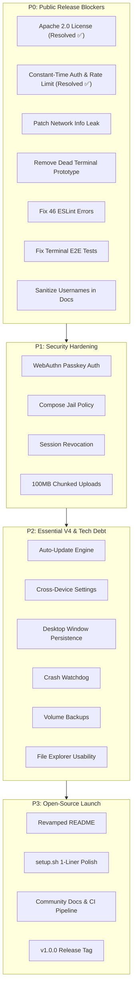

# Home Cloud — Open-Source Launch Roadmap & Pre-Release Checklist

This document catalogs all prerequisite architectural fixes, security hardening, feature completions, test suite stabilizations, and repository polishing required before making **Home Cloud** publicly accessible as an open-source project on GitHub.

---

## 📊 Release Readiness Scorecard

| Category | Status | Blocking Severity | Key Issues / Gaps |
| :--- | :---: | :---: | :--- |
| **P0: Public Release Blockers** | ⚠️ Action Required | **CRITICAL** | Unauthenticated host leak, dead prototype code, 46 ESLint errors, 8 failing tests. *(License ✅, Auth hardening ✅)* |
| **P1: Security & Privilege Boundaries** | ⚠️ High Priority | **HIGH** | Passkey (WebAuthn) login, Compose jail bypass, unrevocable 7-day JWTs, static `.env` passcode, 100MB tunnel upload cap. |
| **P2: Essential V4 & Tech Debt Milestones** | ⏳ In Progress | **MEDIUM** | Auto-update engine, cross-device settings persistence, desktop window state restoration, crash watchdog, file explorer keyboard nav. |
| **P3: Open-Source Polish & Governance** | 📝 Planned | **LOW** | 1-line curl installer, modernized `README.md`, `CONTRIBUTING.md`, `SECURITY.md`, GitHub Actions CI. |

---

## 🚨 Priority 0: Public Release Blockers (Hard Gates)

These items **must** be resolved before the repository visibility is changed to public. Neglecting any of these risks legal ambiguity, immediate credential vulnerability, or severe user onboarding failure.

### 1. Open-Source License Applied (Resolved ✅)
* **Status**: Resolved (Apache License, Version 2.0).
* **Verification**:
  * Verified [`LICENSE`](file:///home/rudra-unix/orca/workspaces/home_cloud/siren/LICENSE) exists in root with full Apache 2.0 terms and `Copyright 2026 Rudra Agrawal (Cypher0071)`.
  * Verified consistent SPDX identifier `"license": "Apache-2.0"` in root [`package.json`](file:///home/rudra-unix/orca/workspaces/home_cloud/siren/package.json#L13) and [`agent/package.json`](file:///home/rudra-unix/orca/workspaces/home_cloud/siren/agent/package.json#L12).
  * Tested and validated on both `Cypher-0071/siren` and `main` branches.

---

### 2. Constant-Time Authentication & Login Rate Limiting (Resolved ✅)
* **Status**: Resolved.
* **Resolution**:
  * Implemented constant-time password comparison in [`agent/routes/auth.js`](file:///home/rudra-unix/orca/workspaces/home_cloud/siren/agent/routes/auth.js) using `crypto.timingSafeEqual` with SHA-256 pre-hashed buffers. Eliminates string comparison timing attacks and variable-length buffer exceptions.
  * Implemented an in-memory sliding window rate limiter and brute-force lockout:
    * 5 failed attempts within 60 seconds triggers a 5-minute temporary IP lockout.
    * Returns HTTP `429 Too Many Requests` with standard `Retry-After` header and remaining lockout seconds.
    * Extracts client IP accurately across reverse proxies and Cloudflare Tunnels (`cf-connecting-ip`, `x-forwarded-for`, `req.ip`).
    * Resets failed attempt counter immediately upon successful password authentication.
    * Unref'd background garbage collector evicts expired records every 5 minutes.
* **Verification**:
  * Validated with automated test suite in [`agent/tests/verify_auth.mjs`](file:///home/rudra-unix/orca/workspaces/home_cloud/siren/agent/tests/verify_auth.mjs). Verified exact match, character mismatch, length variance, non-string guards, multi-attempt lockout, retry headers, IP isolation, and post-login counter clearance.

---

### 3. Patch Unauthenticated Host Information Disclosure
* **Problem**: In [`agent/index.js:L80`](file:///home/rudra-unix/orca/workspaces/home_cloud/siren/agent/index.js#L80), `/api/network` is mounted **before** `authMiddleware`:
  ```javascript
  // Network metadata (local IP discovery for LAN switching)
  app.use("/api/network", require("./routes/network"));

  // Authenticated endpoints
  app.use("/api", authMiddleware);
  ```
  In [`agent/routes/network.js:L7-L36`](file:///home/rudra-unix/orca/workspaces/home_cloud/siren/agent/routes/network.js#L7-L36), `GET /api/network/info` returns `serverLocalIp`, `serverLocalPort`, `baseDir` (`/home/<username>`), `cfDomain`, and full tunnel status. An unauthenticated attacker navigating to `https://dash.<your-domain>/api/network/info` can immediately harvest the host server's local subnet IP, server username, and filesystem root without credentials.
* **Target Files**:
  * [`agent/index.js`](file:///home/rudra-unix/orca/workspaces/home_cloud/siren/agent/index.js#L80-L83)
  * [`agent/routes/network.js`](file:///home/rudra-unix/orca/workspaces/home_cloud/siren/agent/routes/network.js)
* **Required Action**:
  * Move `/api/network/info` behind `authMiddleware`.
  * If LAN auto-detection requires an unauthenticated endpoint, create a minimal, sanitized ping endpoint (`/api/ping` or `/api/network/ping`) that only returns `{ status: "ok" }` and zero internal system paths, usernames, or network interface metadata.

---

### 4. Remove Dead & Hardcoded Standalone Terminal Prototype
* **Problem**: [`dashboard/src/pages/terminal.tsx`](file:///home/rudra-unix/orca/workspaces/home_cloud/siren/dashboard/src/pages/terminal.tsx#L13) is an obsolete 34-line prototype that hardcodes `wss://home-cloud.live/terminal` directly.
* **Risk**: If anyone hits `/terminal` directly, it attempts to connect to the author's personal domain rather than their own server. The production terminal is [`dashboard/src/components/apps/TerminalApp.tsx`](file:///home/rudra-unix/orca/workspaces/home_cloud/siren/dashboard/src/components/apps/TerminalApp.tsx).
* **Required Action**:
  * Delete `dashboard/src/pages/terminal.tsx` completely.
  * Verify `dashboard/src/App.tsx` routes cleanly to the desktop shell and terminal window.

---

### 5. Fix 46 ESLint Violations in Frontend
* **Problem**: Running `pnpm --filter dashboard lint` yields 46 problems (45 errors, 1 warning) inside [`dashboard/src/pages/files.tsx`](file:///home/rudra-unix/orca/workspaces/home_cloud/siren/dashboard/src/pages/files.tsx).
* **Specific Violations**:
  * Synchronous `setState` calls directly inside `useEffect` (`loadDirectory(currentPath)`, `setSearchResults([])`) breaking React 19 compiler optimization rules (`react-hooks/set-state-in-effect`).
  * Explicit `any` usages on lines 551, 933, 1020, 1066 (`@typescript-eslint/no-explicit-any`).
  * Missing dependencies in keyboard shortcut `useEffect` hooks (`react-hooks/exhaustive-deps`).
* **Required Action**:
  * Refactor `loadDirectory` and search state setters into event-driven or callback patterns.
  * Define explicit TypeScript interfaces for file payloads and event handlers.
  * Ensure `pnpm --filter dashboard lint` exits cleanly with `0` errors.

---

### 6. Stabilize Automated Test Suites
* **Problem**:
  1. Root [`package.json`](file:///home/rudra-unix/orca/workspaces/home_cloud/siren/package.json) lacks a unified `pnpm test` script.
  2. The E2E test runner [`.agents/tests/terminal_e2e.test.mjs`](file:///home/rudra-unix/orca/workspaces/home_cloud/siren/.agents/tests/terminal_e2e.test.mjs) currently fails 8 test cases (`T1.28`, `T1.29`, `T1.40`, `T2.24`, `T2.38`, `T3.1`, `T3.4`, `T3.5`) because the tests expect obsolete regex patterns that changed during the mobile toolbar and `SESSION_ID` refactor.
* **Required Action**:
  * Update terminal test assertions to match the current `TerminalApp.tsx` implementation.
  * Add a standard `pnpm test` command in root `package.json` running agent tests and dashboard validation.

---

### 7. Sanitize Hardcoded Usernames & Example Domains in Docs
* **Problem**: Documentation examples in [`docs/SYSTEM_DESIGN.md`](file:///home/rudra-unix/orca/workspaces/home_cloud/siren/docs/SYSTEM_DESIGN.md) and [`docs/CONTEXT.md`](file:///home/rudra-unix/orca/workspaces/home_cloud/siren/docs/CONTEXT.md) refer to `/home/rudra-unix/` and personal Cloudflare account UUIDs (`43a28f80-...`).
* **Required Action**:
  * Replace personal usernames with standard placeholders (`/home/<user>/` or `$HOME`).
  * Replace specific Cloudflare tunnel UUIDs with generic `<tunnel-id>` placeholders.

---

## 🔒 Priority 1: Security & Privilege Boundary Hardening

Production-grade self-hosted tools must withstand exposure to the open internet. The following security upgrades prevent host takeover and data leakage.

### 1. Passkey / WebAuthn (FIDO2) Authentication Support
* **Source**: [`todo.md`](file:///home/rudra-unix/orca/workspaces/home_cloud/siren/todo.md#L4) & [`docs/TECHNICAL_DEBT.md:L101`](file:///home/rudra-unix/orca/workspaces/home_cloud/siren/docs/TECHNICAL_DEBT.md#L101)
* **Goal**: Enable hardware keys (YubiKey), Touch ID, Face ID, and Windows Hello via WebAuthn.
* **Architecture**:
  * Implement `@simplewebauthn/server` in `agent/routes/auth.js` (`/api/auth/webauthn/register-options`, `/api/auth/webauthn/verify-registration`, `/api/auth/webauthn/login-options`, `/api/auth/webauthn/verify-authentication`).
  * Implement `@simplewebauthn/browser` in `dashboard/src/pages/login.tsx`.
  * Store credentials in host storage (`~/.config/home-cloud/webauthn.json`).
  * Maintain password login as a fallback.

---

### 2. Docker Compose Privilege Escalation Protection
* **Source**: [`docs/TECHNICAL_DEBT.md:L61`](file:///home/rudra-unix/orca/workspaces/home_cloud/siren/docs/TECHNICAL_DEBT.md#L61)
* **Goal**: Prevent bypass of the single-container filesystem jail via Compose deployments.
* **Architecture**:
  * While single-container creation in [`agent/routes/docker.js`](file:///home/rudra-unix/orca/workspaces/home_cloud/siren/agent/routes/docker.js) validates and jails paths within `BASE_DIR`, Compose stacks (`agent/routes/compose.js`) execute raw YAML that can bind-mount `/`, `/etc/shadow`, or `/var/run/docker.sock`.
  * Add a Compose parser/pre-flight validator that checks volume declarations.
  * If a Compose file attempts to bind mount directories outside `BASE_DIR`, require explicit user confirmation or flag high-privilege operations in the UI.

---

### 3. Server-Side Session Revocation & Token Epoch
* **Source**: [`docs/TECHNICAL_DEBT.md:L68`](file:///home/rudra-unix/orca/workspaces/home_cloud/siren/docs/TECHNICAL_DEBT.md#L68)
* **Goal**: Immediate invalidation of JWT cookies on logout or passcode change.
* **Architecture**:
  * Currently, JWTs are signed with a 7-day expiration and cannot be revoked without changing `JWT_SECRET` and restarting the process.
  * Introduce a lightweight `session_epoch` integer or token blacklist persisted in agent memory / local config file.
  * When the user clicks **Logout** or changes their passcode, increment the epoch so all previous tokens fail verification immediately.

---

### 4. Dynamic Passcode Management UI & Endpoint
* **Source**: [`docs/TECHNICAL_DEBT.md:L74`](file:///home/rudra-unix/orca/workspaces/home_cloud/siren/docs/TECHNICAL_DEBT.md#L74)
* **Goal**: Allow users to change their master passcode from the dashboard rather than requiring terminal SSH to edit `agent/.env`.
* **Architecture**:
  * Endpoint `POST /api/settings/password` requiring current password + new password.
  * Safe in-place update of `agent/.env` (retaining comments and formatting) with immediate session revocation.

---

### 5. Resumable Chunked File Uploads (100MB Cloudflare Tunnel Cap)
* **Source**: [`docs/TECHNICAL_DEBT.md:L125`](file:///home/rudra-unix/orca/workspaces/home_cloud/siren/docs/TECHNICAL_DEBT.md#L125)
* **Goal**: Enable uploading files >100MB over remote Cloudflare Tunnels without triggering HTTP `413 Request Entity Too Large`.
* **Architecture**:
  * Cloudflare Free and Pro tunnels strictly enforce a 100MB request body limit.
  * Implement client-side slicing into 50MB chunks in File Explorer (`dashboard/src/pages/files.tsx`).
  * Implement chunk assembly endpoints (`POST /api/files/upload/chunk` and `POST /api/files/upload/complete`) using streaming append or temporary chunk caches on the agent.

---

## ⚡ Priority 2: Essential V4 & Tech Debt Feature Additions

Features that must ship for the 1.0 release to deliver a complete, resilient self-hosted operating experience.

### 1. One-Click Auto-Update Engine & Release Pipeline
* **Source**: [`docs/implementation/v4_roadmap.md:L50`](file:///home/rudra-unix/orca/workspaces/home_cloud/siren/docs/implementation/v4_roadmap.md#L50)
* **Goal**: Enable non-technical users to update Home Cloud with a single click.
* **Architecture**:
  * Backend polling service checking GitHub Releases (`GET https://api.github.com/repos/Cypher0071/home_cloud/releases/latest`).
  * Update runner executing:
    1. Git fetch and checkout of verified release tag.
    2. `pnpm install --frozen-lockfile`.
    3. `pnpm --filter dashboard build`.
    4. Service reload via `systemctl restart home-cloud`.
  * Auto-rollback if post-update health check fails within 30 seconds.
  * Dashboard notification badge and release notes preview modal.

---

### 2. Cross-Device Settings & Personalization Persistence
* **Source**: [`docs/TECHNICAL_DEBT.md:L142`](file:///home/rudra-unix/orca/workspaces/home_cloud/siren/docs/TECHNICAL_DEBT.md#L142)
* **Goal**: Synchronize wallpaper, theme, fit mode, and dock preferences across all user devices.
* **Architecture**:
  * Endpoint `GET/PUT /api/settings/preferences` backed by host-side JSON storage (`~/.config/home-cloud/preferences.json`).
  * Asset endpoint `POST /api/settings/wallpaper` to store custom wallpaper images on the host server.
  * Update frontend hooks (`useWallpaper.ts`) to use optimistic UI updates with background server synchronization.

---

### 3. Desktop Window Layout State Persistence
* **Source**: [`docs/implementation/v4_roadmap.md:L39`](file:///home/rudra-unix/orca/workspaces/home_cloud/siren/docs/implementation/v4_roadmap.md#L39)
* **Goal**: Restore open window positions (`x`, `y`), dimensions (`width`, `height`), and z-indices across browser reloads.
* **Architecture**:
  * Save open window state to browser `localStorage` on window move/resize with debounce.
  * Restore window positions and active states upon dashboard re-entry.

---

### 4. Container Crash Watchdog & Webhooks
* **Source**: [`docs/implementation/v4_roadmap.md:L9`](file:///home/rudra-unix/orca/workspaces/home_cloud/siren/docs/implementation/v4_roadmap.md#L9)
* **Goal**: Automatic notifications if a Docker service crashes or enters a restart loop.
* **Architecture**:
  * Node.js agent monitors Docker events via `docker.getEvents()`.
  * Detect non-zero container exit codes, unhealthy states, and OOM kills.
  * Dispatch alert cards to Telegram and Discord webhooks with container name, status, and trailing log lines.

---

### 5. Automated Volume & Database Backups
* **Source**: [`docs/implementation/v4_roadmap.md:L25`](file:///home/rudra-unix/orca/workspaces/home_cloud/siren/docs/implementation/v4_roadmap.md#L25)
* **Goal**: Protect user container data with zero terminal complexity.
* **Architecture**:
  * Snapshot Docker named volumes and container bind mounts into `.tar.gz` archives.
  * Configurable backup schedules (daily/weekly) with automatic retention rotation.
  * Dashboard panel to list, trigger, and download backup archives.

---

### 6. File Explorer Usability Upgrades
* **Source**: [`docs/TECHNICAL_DEBT.md:L109-L121`](file:///home/rudra-unix/orca/workspaces/home_cloud/siren/docs/TECHNICAL_DEBT.md#L109-L121)
* **Goal**: Bring File Explorer up to desktop parity.
* **Architecture**:
  * Keyboard navigation: Arrow keys to navigate items, `Enter` to open, `Delete` / `Backspace` to delete, `F2` to rename.
  * Layout Switcher: Toggle between Tabular List view and Grid/Tiles view (ideal for image directories).
  * Details Sidebar: Collapsible pane displaying file metadata, mime type, permissions, and image preview.

---

## 📦 Priority 3: Open-Source Distribution, Packaging & Developer Experience

Final polish required for public GitHub launch, contributor attraction, and friction-free user onboarding.

### 1. 1-Command Automated Installer (`curl | bash`)
* **Goal**: Seamless onboarding for fresh Linux servers.
* **Architecture**:
  * Ensure [`setup.sh`](file:///home/rudra-unix/orca/workspaces/home_cloud/siren/setup.sh) can be invoked via:
    ```bash
    curl -fsSL https://raw.githubusercontent.com/Cypher0071/home_cloud/main/setup.sh | bash
    ```
  * Verify automated dependency resolution across Ubuntu, Debian 12, Fedora, and Arch Linux.
  * Provide non-interactive flags (e.g. `--domain example.com --tunnel my-tunnel --password mypass`).

---

### 2. Comprehensive `README.md` Revamp
* **Target File**: [`README.md`](file:///home/rudra-unix/orca/workspaces/home_cloud/siren/README.md)
* **Required Content**:
  * Hero banner, badge bar (CI, License, Node 20+, Docker).
  * High-level architectural diagram (Browser -> Cloudflare Tunnel -> Agent -> Docker/Terminal/Files).
  * Quickstart guide (1-command setup vs manual Docker/Node run).
  * Security model & threat boundary explanation (single-user model, CGNAT traversal).
  * High-res screenshot showcase (Desktop environment, Docker store, Web terminal, File explorer).

---

### 3. Open-Source Community Guidelines & Templates
* **Target Files**:
  * `CONTRIBUTING.md` — Guide for local setup, PR workflows, code style, and testing requirements.
  * `CODE_OF_CONDUCT.md` — Contributor Covenant v2.1.
  * `SECURITY.md` — Responsible disclosure policy and reporting process.
  * `.github/ISSUE_TEMPLATE/` — Structured templates for Bug Reports and Feature Requests.
  * `.github/PULL_REQUEST_TEMPLATE.md` — Checklist for PR authors.

---

### 4. GitHub Actions CI/CD Pipeline
* **Target File**: `.github/workflows/ci.yml`
* **Automated Checks**:
  * Monorepo linting (`pnpm run lint`).
  * TypeScript typecheck (`tsc -b`).
  * Production frontend build verification (`pnpm --filter dashboard build`).
  * Automated backend test suite execution (`pnpm test`).

---

## 🎯 Step-by-Step Execution Plan



### Execution Phases:
1. **Phase 1 (P0)**: Fix immediate blockers (License ✅, Auth hardening ✅, information leak, delete dead terminal prototype, fix ESLint and E2E tests).
2. **Phase 2 (P1)**: Implement passkey authentication, server session revocation, and 100MB chunked uploads.
3. **Phase 3 (P2)**: Implement Auto-Update Engine (V4 Phase 4), cross-device settings persistence, and desktop window state persistence.
4. **Phase 4 (P3)**: Polish `README.md`, installer script, community templates, and publish v1.0.0 release.
